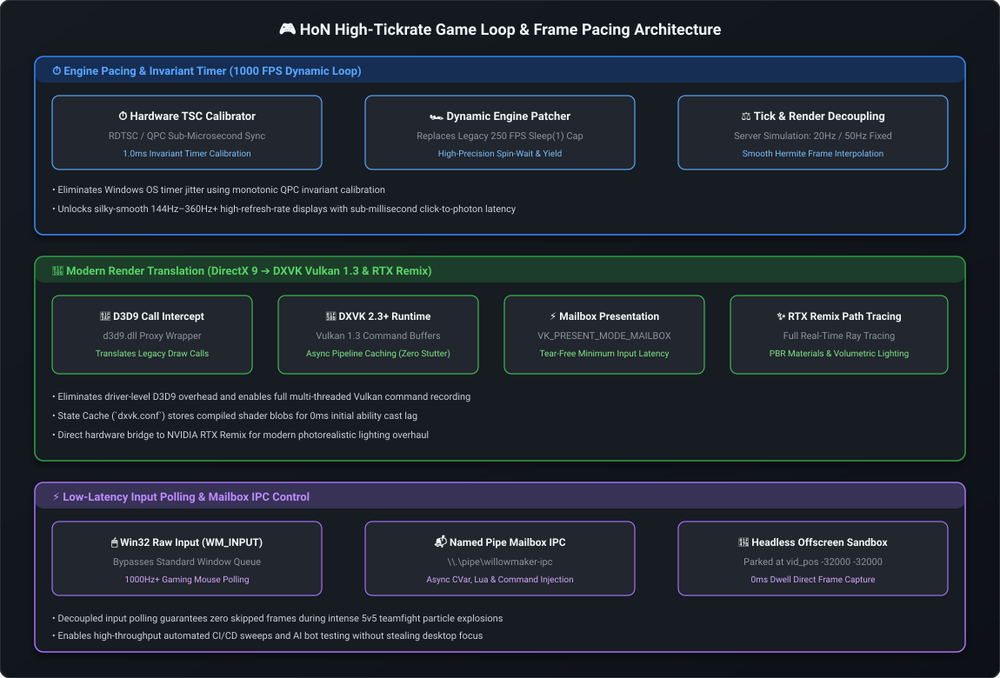
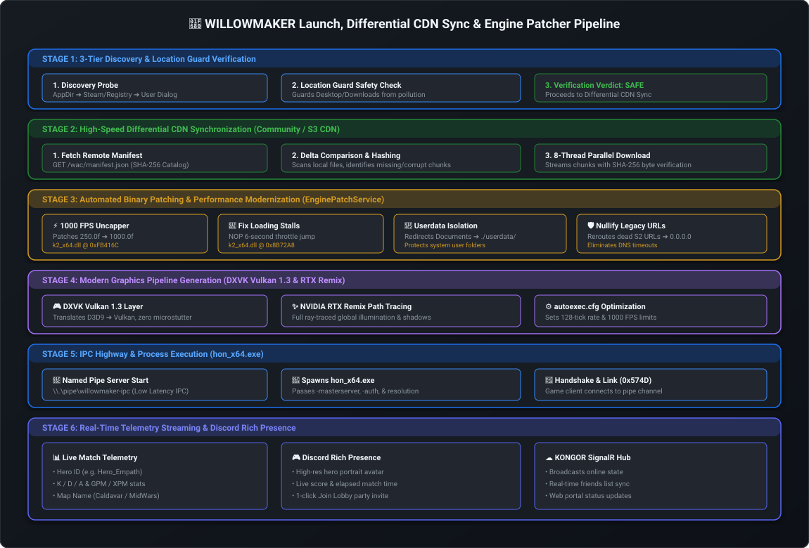
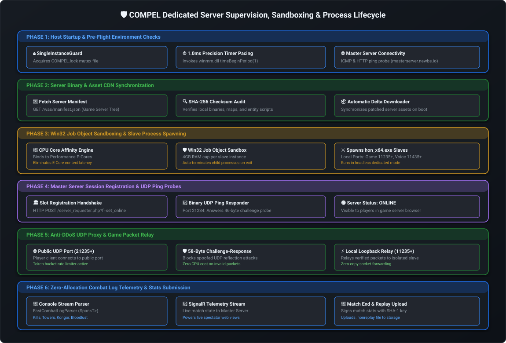
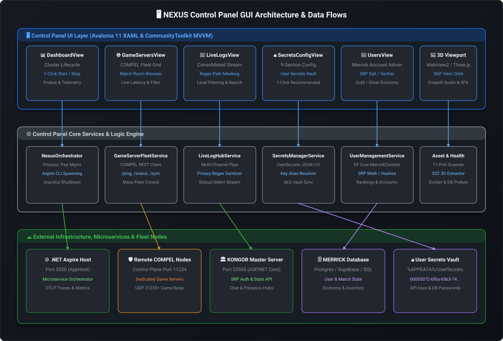
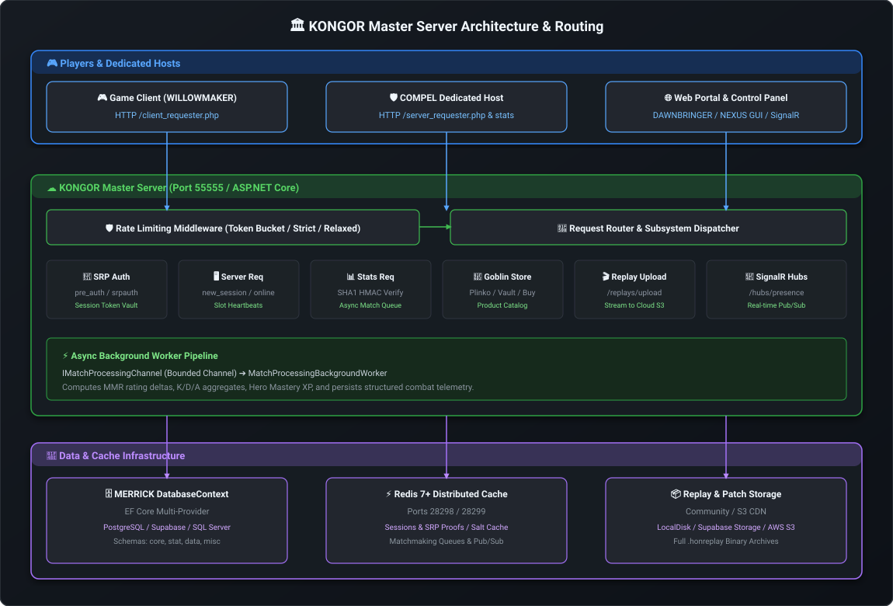
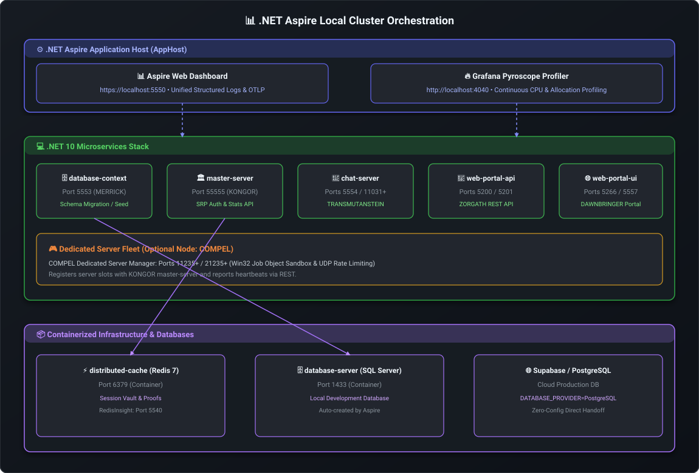
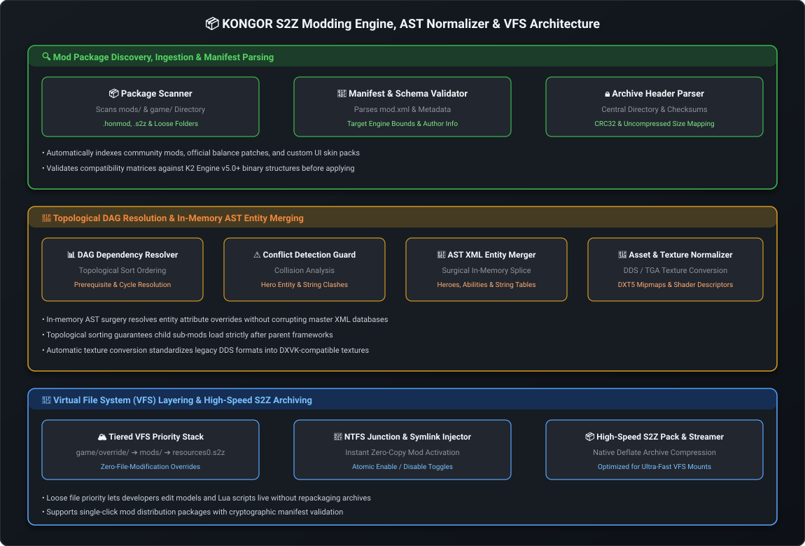
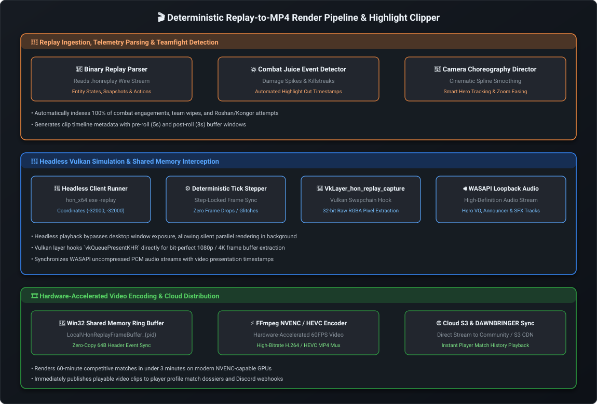
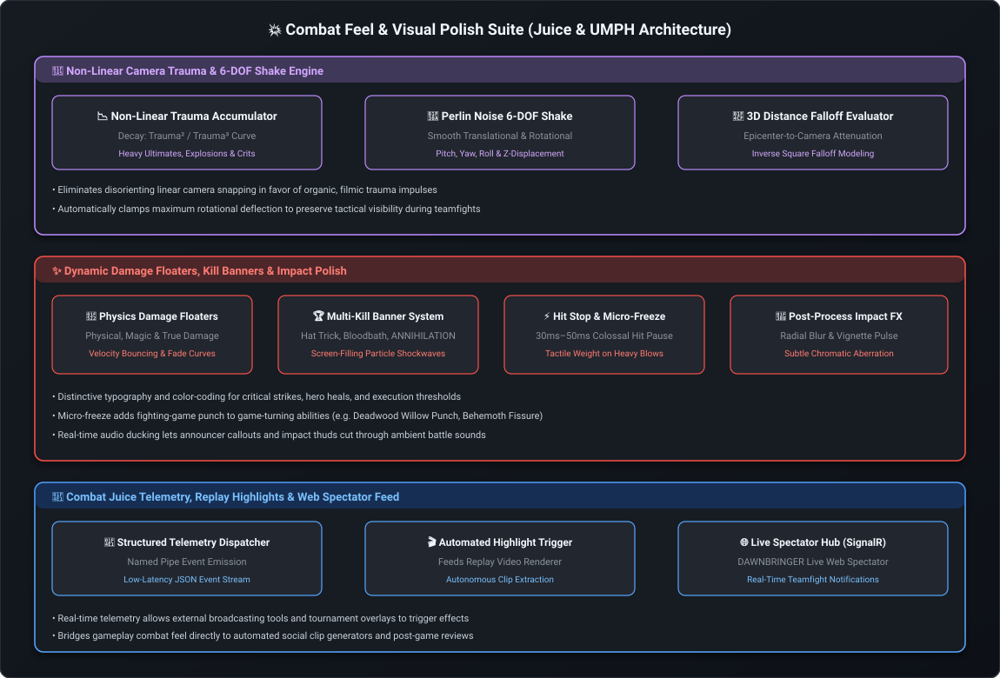

# 🏛️ Project Kongor Architecture Hub

This directory gathers foundational system architecture blueprints, topological diagrams, and operational specifications for Project Kongor.

---

## 📑 Architecture Specifications Index

| Specification | Description | Target Subsystems |
|---|---|---|
| **[`ecosystem.md`](./ecosystem.md)** | **5-Tier Ecosystem Architecture**: The authoritative topology spanning desktop clients, COMPEL server fleet, ASP.NET microservices, and cloud databases. | All Subsystems |
| **[`self-healing.md`](./self-healing.md)** | **Autonomous Self-Healing Triangulation**: The Self-Healing Hexad (TAO, Proximo, WinDbg, Ghidra, Willowmaker, Compel) for closed-loop native crash triage and detour patching. | Engine Runtimes, Native DLLs |
| **[`../tao-mcp/architecture.md`](../tao-mcp/architecture.md)** | **Together As One (TAO) Architecture**: Deep specification of the Empath-style MCP architecture, zero-lock shadow runtimes, and Tier 0 Vulkan swapchain frame grabbing. | MCP Server, AI Automation |
| **[`../audits/STATUS.md`](../audits/STATUS.md)** | **Audit Status Tracker**: Which audit recommendations were verified against code and actioned (✅/🟡/⬜/❌). Update this instead of writing new audits. | All Subsystems |
| **[`../archive/audits/cohesion_audit/`](../archive/audits/cohesion_audit/MASTER_COHESION_BLUEPRINT.md)** | Cohesion audit suite #1 (per-component audits + master blueprint). Findings not yet fully verified — see `STATUS.md`. | All Subsystems |
| **[`../archive/audits/opus_cohesion_audit/`](../archive/audits/opus_cohesion_audit/09_executive_summary.md)** | Cohesion audit suite #2 (9 documents incl. modernization roadmap). Findings not yet fully verified — see `STATUS.md`. | All Subsystems |
| **[`../roadmaps/game_server_modernization.md`](../roadmaps/game_server_modernization.md)** | Dedicated game server modernization roadmap (hon_x64, COMPEL, UDPForwarder, Agones, matchmaking). Strategy doc, not yet verified against code — see `STATUS.md`. | Game Server Fleet |
| **[`replay-studio-future-work.md`](./replay-studio-future-work.md)** | **NEXUS Replay Studio (Deferred Future Work)**: Architecture blueprint for on-demand headless Linux Docker K2 game client POV replay recording for remote Staff moderation. | Web Portal, Docker Worker, K2 Client |

---

## 🎨 Subsystem Architecture Diagrams

| Diagram | Subsystem | Canonical Module |
|---|---|---|
| **Ecosystem Topology** | Full 5-tier platform & data flow | [`ecosystem.md`](./ecosystem.md) |
| **Game Loop & Vulkan Modernization** | 1.0 ms engine pacing, DXVK Vulkan 1.3 & low-latency input | [`WILLOWMAKER`](../../src/apps/willowmaker/README.md) |
| **WILLOWMAKER Pipeline** | Client launch, CDN manifest sync & 1000 FPS patching | [`WILLOWMAKER`](../../src/apps/willowmaker/README.md) |
| **COMPEL Lifecycle** | Dedicated server supervisor, Job Object sandbox & UDP proxy | [`COMPEL`](../../src/apps/compel/README.md) |
| **NEXUS Control Panel** | Avalonia 11.2.3 GUI, Docker Stack, Three.js 3D viewer & vault | [`NEXUS Control Panel`](../../src/apps/control-panel/README.md) |
| **KONGOR Master Server** | SRP-6a auth, MERRICK multi-DB, Goblin store & stats | [`KONGOR Master Server`](../../src/services/master-server/README.md) |
| **.NET Aspire Orchestration** | Local microservice topology, Garnet/Redis & OpenTelemetry | [`ASPIRE AppHost`](../../src/services/aspire-host/README.md) |
| **Mod Pipeline** | `.honmod` DAG resolution, XML merging & VFS precedence | [`Kongor.Modding`](../../src/extensions/modding/README.md) |
| **Replay Renderer & Combat Juice** | Vulkan swapchain capture, NVENC MP4 & highlight telemetry | [`NEXUS.ReplayRenderer`](../../src/extensions/replay-renderer/README.md) |

