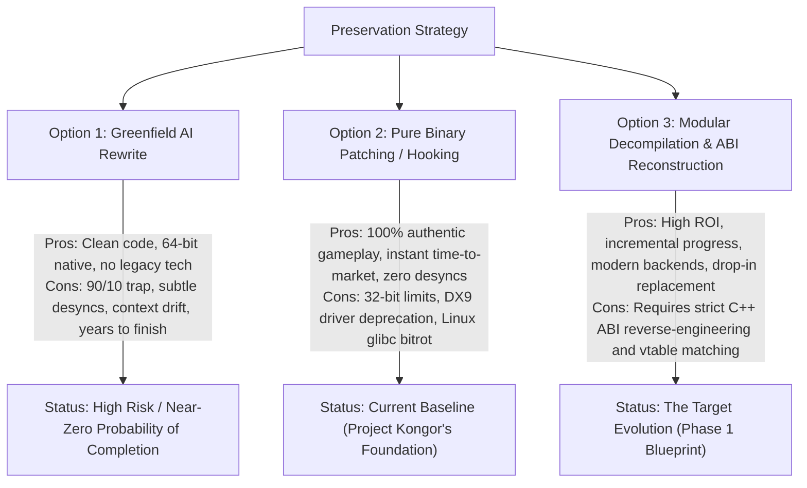
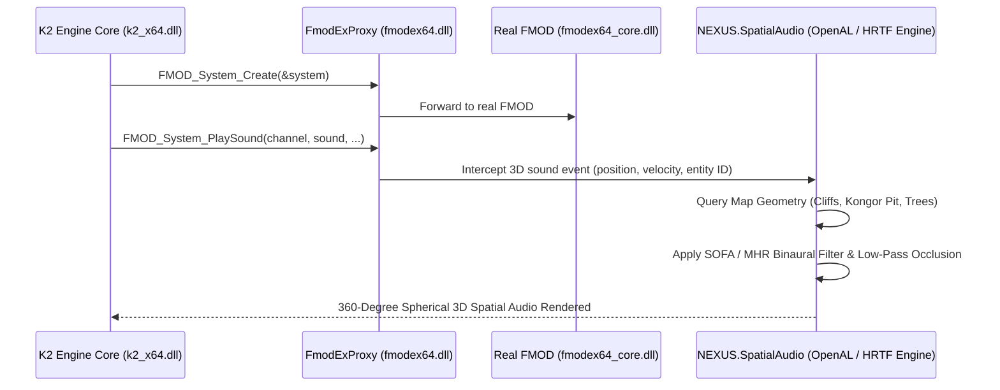
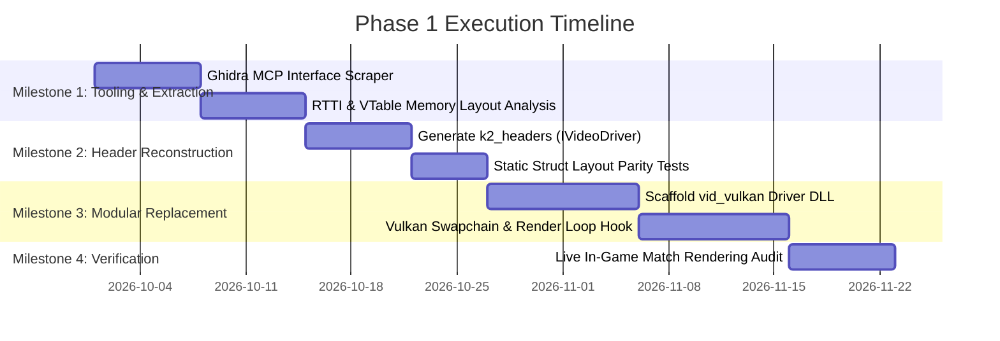

# Complex Engineering: K2 Modular Decompilation, Binary Augmentation & Subsystem Evolution

> **Status:** Architectural Strategy & Implementation Blueprint  
> **Author:** Project Kongor Engineering Team  
> **Scope:** Engine Modernization, Reverse Engineering, Native Hooks, and Modular Source Reconstruction  

---

## 1. Executive Summary & Engineering Philosophy

Preserving and modernizing a 15-year-old competitive game engine (K2 Engine / Heroes of Newerth) presents a classic software engineering trilemma:



### The "Greenfield AI Rewrite" Fallacy
Attempting to rewrite HoN from scratch in conversational LLM sessions (e.g., prompting Claude Pro in fresh web chats) invariably runs into the **90/10 Game Engine Trap**:
1. **The First 10% (The Honeymoon Phase):** Getting a mesh moving on a heightmap, drawing basic health bars, and exchanging raw UDP connection packets can be done in a few weekends. It looks convincing in screenshots and teaser videos.
2. **The Remaining 90% (The Reality of Competitive MOBAs):** 15 years of accumulated engine edge cases:
   * **Deterministic Simulation:** Frame-accurate lockstep simulation ticks, sub-tick input queueing, client prediction, and snapshot delta compression.
   * **Complex Ability Interactions:** Over 130 heroes, hundreds of items, thousands of XML modifier interactions, disjoint mechanics, channel interruptions, invulnerability frames, and modifier stacking precedence.
   * **Navigation & Physics:** Dynamic unit collision boxes, sliding against path tiles, cliff elevation vision logic, and pathfinder smoothing.
3. **Context Drift & Hallucination:** Starting fresh LLM sessions without automated repo-wide AST validation or live binary grounding causes the model to contradict earlier architecture, invent incompatible APIs, and introduce subtle simulation discrepancies that make competitive play impossible.

---

## 2. K2 Engine Binary Topology & Module Breakdown

K2 was designed in the mid-2000s with modularity in mind. On Windows x64 (and x86), the engine is divided into distinct dynamic libraries:

| Module | Binary Size | Est. C++ LOC | Primary Architecture & Responsibilities | Decomp / Rewrite Feasibility |
| :--- | :--- | :--- | :--- | :--- |
| **`k2_x64.dll`** | **19.8 MB** | ~1.5M - 2M | Core engine kernel: Virtual File System (VFS/`.s2z`), memory allocators, scene graph, culling, resource management, core math, input dispatch. | **Near-Zero (Monolithic)** |
| **`game_shared_x64.dll`** | **8.05 MB** | ~400k - 600k | Shared simulation core: Entity state management, XML modifier engine, snapshot serialization, combat resolution, navigation grid, projectile tracking. | **Low (Desync Trap)** |
| **`cgame_x64.dll`** | **2.97 MB** | ~150k - 250k | Client-side game logic: Local player prediction, camera rigging, HUD rendering, local VFX/sound triggers, client command buffering. | **Medium** |
| **`game_x64.dll`** | **1.2 MB** | ~80k - 120k | Server match orchestration: Server entity dispatch, bot choreography, game state transitions, disconnect handling. | **Medium** |
| **`vid_d3d9_x64.dll`** | **962 KB** | ~40k - 60k | Graphics hardware abstraction: Direct3D 9 renderer driver implementing the `IVideoDriver` interface. | **High (Prime Candidate)** |
| **`vid_gl2_x64.dll`** | **949 KB** | ~40k - 60k | Legacy OpenGL 2.1 renderer driver. | **High** |
| **`fmodex64.dll`** | **External** | N/A | Commercial FMOD Ex sound engine interface (C-linkage API). | **Proven (Already Intercepted)** |

---

## 3. The C++ ABI Fragility Trap

The reason full modular replacement of `game_shared.dll` or `k2.dll` has not been undertaken historically is the **C++ Application Binary Interface (ABI) barrier**:

```
+-----------------------------------------------------------------------+
|                             k2_x64.dll                                |
|  Calls virtual method: m_pEntity->UpdateState()                       |
|  Assumes vtable offset: [rax + 0x68]                                  |
|  Assumes member offset: m_v3Position at offset [rcx + 0x120]          |
+-----------------------------------------------------------------------+
                                  |
                  (Cross-DLL Virtual Dispatch)
                                  v
+-----------------------------------------------------------------------+
|                   Custom Recompiled game_shared.dll                   |
|  If compiler added padding or reordered virtual methods:              |
|  - vtable offset [rax + 0x68] -> Calls DeleteEntity() instead!        |
|  - member offset [rcx + 0x120] -> Reads unaligned garbage memory!      |
|  Result: 0xC0000005 (EXCEPTION_ACCESS_VIOLATION)                      |
+-----------------------------------------------------------------------+
```

### Key Technical Obstacles in C++ DLL Swapping:
1. **VTable Alignment & Ordering:** Virtual methods must match the exact index order in the binary's vtable. If an interface has 60 virtual methods and one is missing or transposed, all subsequent calls invoke the wrong method.
2. **Class Memory Footprint & Alignment:** Classes inherit across DLL boundaries (`IGame`, `CClientEntity`, `IGameEntity`, `CEntitySnapshot`). If `sizeof(IGameEntity)` is 496 bytes in stock `k2.dll`, but a recompiled header calculates 488 bytes due to MSVC structure packing (`#pragma pack`), all heap allocations and array indexing corrupt memory.
3. **Cross-DLL Heap Allocation (`new`/`delete`):** Freeing memory allocated in another DLL compiled with a different runtime CRT causes immediate heap corruption. (This is why Project Kongor uses `mimalloc-override.dll` and `mimalloc-redirect.dll` to unify process-wide allocation).

### 3.1 Empirical Case Study: The 64-Bit Pointer Truncation Trap (Slot +0x078)
During live testing of the Phase 1 modular video driver (`vid_vulkan_x64.dll`), we encountered a textbook manifestation of this ABI fragility:
* **The Symptom:** On Frame #2 after establishing the main window, the client crashed with `0xC0000005 (EXCEPTION_ACCESS_VIOLATION)` at `vid_d3d9_x64.dll+0x744FE`.
* **The Assembly Ground Truth:** Instruction `0x744FE` is `movsd xmm0, qword ptr [r13 + 0x24]`. Register `r13` held `0x000000002B83D5D8`—an unmapped bottom-4GB memory address.
* **The Root Cause:** Slot `+0x078` was initially hypothesized as `Clear(uint32_t flags, uint32_t color, float depth)`. In reality, it is `SetCamera(const CCamera* pCamera)`. The 64-bit engine passed pointer `0x000002962B83D5D8` in `RCX`. Because the wrapper typed the parameter as `uint32_t flags`, the MSVC x64 compiler zero-extended `ecx`, wiping out the upper 32 bits (`0x00000296` $\to$ `0x00000000`).
* **The Floating-Point Hazard:** Generic C++ forwarding thunks with integer parameters also clobber volatile `XMM0..XMM3` registers whenever helper functions (such as logging) are invoked prior to dispatching, corrupting floating-point 2D/3D geometry.
* **The Lesson:** Unverified slots must never be typed with 32-bit parameters. The safest modernization strategy is **Hybrid Selective Forwarding**: hook only proven high-level lifecycle methods, while leaving all high-frequency inner rendering and buffer slots pointing directly to stock machine code.

---

## 4. The Audio Subsystem Deep Dive (The Working Blueprint)

While monolithic C++ libraries are fragile, **audio is the quintessential proof that modular modernization works**.

### 4.1 Historical Architecture
K2 used Firelight Technologies' **FMOD Ex** (`fmodex64.dll` / `fmodex.dll`).
* **Limitations:** Classic 2D stereo panning, rudimentary linear distance attenuation, lack of elevation cues, and no physical occlusion when spells occur behind high-ground cliffs or Kongor's pit.
* **Why it was modular:** Unlike K2's internal C++ classes, FMOD Ex exposes a **pure C-linkage API** (`extern "C" __stdcall`). C APIs have fixed calling conventions and zero vtable fragility!

### 4.2 Modernization Architecture: `NEXUS.SpatialAudio`
Project Kongor modernizes the entire audio pipeline in `src/extensions/spatial-audio` using a drop-in proxy bridge:



### 4.3 Implemented Features in `src/extensions/spatial-audio`:
* **Binaural HRTF Spatialization:** Simulates acoustic diffraction across the human pinna, head, and torso to provide true 360-degree spherical and vertical elevation cues over stereo headphones.
* **Drop-In FMOD Ex Interception (`native/src/FmodExProxy.cpp`):** Intercepts standard FMOD calls (`FMOD_System_Create`, `FMOD_Memory_Initialize`, `FMOD_Memory_GetStats`) and redirects calls while preserving core sound synthesis.
* **Custom Ear-Print Profiles (SOFA & MHR):** Scans and loads AES69-2015 standard `.sofa` impulse response profiles for personalized acoustics.
* **Geometry Occlusion Damping:** Raycasts sound vectors against terrain heightmaps and world entities to apply real-time low-pass filtering when sound origins are obstructed.
* **128-Voice Spatial Polyphony:** Ultra-low latency 5.3ms mixer with zero audio hitching.

---

## 5. Feasibility Matrix: What to Rewrite vs. What to Hook

| Subsystem / Target | Recommended Strategy | Feasibility | Primary Benefit |
| :--- | :--- | :--- | :--- |
| **Video Driver (`vid_d3d9_x64.dll`)** | **Full Modular Replacement (`vid_vulkan`)** | **High (8.5/10)** | Drops DirectX 9 legacy dependencies; native Vulkan/DX12 rendering; HDR, modern upscalers (FSR/XeSS), and zero-overhead native Linux rendering. |
| **Audio Pipeline (`fmodex64.dll`)** | **Modular Proxy & Extension (Done)** | **High (9.5/10)** | Full HRTF spatialization, geometry occlusion, SOFA profiles without touching K2 engine internals. |
| **Crash Defense & Anti-Cheat (`version.dll`)** | **DLL Proxy & Sentinel Injection (Done)** | **High (9.5/10)** | Process isolation, exception capture, live memory telemetry (`native_guard`). |
| **Client UI & Camera (`cgame_x64.dll`)** | **Selective Decompilation & Hooking** | **Medium (5/10)** | Custom camera smoothing, modern RmlUi HUD overlays, decoupled frame interpolation. |
| **Core Simulation (`game_shared_x64.dll`)** | **Binary Hooking & Detours (MinHook)** | **Low (2/10)** | Preserves 100% bug-for-bug game balance, avoids desync nightmares. |
| **Engine Kernel (`k2_x64.dll`)** | **Memory Patching / Binary Augmentation** | **Extremely Low (1/10)** | Avoids rebuilding a 20MB proprietary monolithic engine from scratch. |

---

## 6. Phase 1 Implementation Plan: Reverse-Engineering & Modular Interface Reconstruction

Phase 1 focuses on building the **mathematical ground truth** and the **first high-ROI modular replacement**: replacing `vid_d3d9_x64.dll` with a native Vulkan backend, while creating the automated header extraction pipeline using Ghidra MCP.



### Step 1: Automated VTable & RTTI Extraction (via Ghidra MCP)
* **Goal:** Extract every virtual function signature, parameter type, and vtable offset from `vid_d3d9_x64.dll` and `k2_x64.dll`.
* **Execution:**
  1. Use Ghidra MCP tools (`search_symbols_by_name`, `list_exports`, `decompile_function`) to analyze the exported entry points of `vid_d3d9_x64.dll`:
     * `InitLibrary(CModManager *pModManager)`
     * `GetDriver()` -> Returns pointer to `IVideoDriver` interface.
  2. Parse the Complete Object Locator and RTTI structures to reconstruct the exact `IVideoDriver` virtual method layout.

### Step 2: Generation of ABI-Compliant C++ Headers (`k2_headers/`)
* **Goal:** Create pristine C++ headers that guarantee bit-for-bit memory and vtable parity with the stock MSVC compiler output.
* **Deliverable:**
  * `native/include/k2/IVideoDriver.h`
  * `native/include/k2/CModManager.h`
  * `native/include/k2/K2Types.h`
* **Static Assertion Harness:** Every generated class must include compile-time alignment assertions:
  ```cpp
  static_assert(sizeof(IVideoDriver) == 0x08, "IVideoDriver interface pointer size mismatch");
  static_assert(offsetof(CRenderDevice, m_hWnd) == 0x38, "Window handle offset mismatch");
  ```

### Step 3: Video Driver Isolation & Modern Vulkan Scaffold (`vid_vulkan`)
* **Goal:** Create a drop-in replacement DLL that exports identical entry points to `vid_d3d9_x64.dll`.
* **Execution:**
  1. Initialize Vulkan instance and link with existing `native/vulkan-layer` swapchain infrastructure.
  2. Implement core rendering primitives of `IVideoDriver`:
     * `StartFrame()` / `EndFrame()` / `Present()`
     * Dynamic vertex/index buffer management.
     * Texture format translation (DXT1/DXT5 -> `VK_FORMAT_BC1_RGB_UNORM_BLOCK` / `VK_FORMAT_BC3_UNORM_BLOCK`).
     * Shader pipeline: Translate K2 `.shader` / HLSL bytecode via SPIRV-Cross to Vulkan SPIR-V.

### Step 4: Struct-Layout & VTable Parity Verification Suite
* **Goal:** Ensure 0% chance of `0xC0000005` access violations before testing with real players.
* **Execution:**
  * Integrate into Project Kongor's CI (`native_guard` / unit test runner) to assert that function dispatch points map to exact hex offsets verified against Ghidra exports.

### Step 5: Proof of Concept Verification
* **Success Criteria:**
  1. HoN boots into main menu with `vid_vulkan.dll` selected in `startup.cfg`.
  2. Hero models, UI meshes, and terrain tiles render correctly without visual artifacts.
  3. Frame time, memory footprint, and stability equal or surpass `vid_d3d9_x64.dll`.
  4. Native Vulkan operation confirmed on both Windows 11 and Linux (via Wine/Proton without DXVK translation penalty).

---

## 7. Summary & Recommendation for Contributors

* **Do not rewrite the world from scratch:** A monolithic greenfield rewrite burns immense effort on solved problems and produces game feel that deviates from 15 years of competitive tuning.
* **Embrace Surgical Modular Replacement:** Audio (`fmodex64`) and Video Driver (`vid_d3d9`) have clean, isolated abstraction layers that yield 95% of modernization benefits (Vulkan, HDR, Spatial Audio, Linux compatibility) at a fraction of the risk.
* **Leverage Binary Truth:** Always base C++ header definitions on decompiled ground truth extracted via Ghidra MCP, backed by compile-time `static_assert` layout checks.

---

## 8. Virtual File System (VFS) & The 4 GB Archive Hard Constraint (`.s2z`)

> [!CAUTION]
> **ENGINE ARCHITECTURE LIMITATION: 32-BIT MINIZIP ARCHIVE OFFSET TRUNCATION**  
> The K2 core kernel (`k2_x64.dll!CArchive`) relies on a 32-bit minizip implementation using standard 32-bit unsigned integer offsets (`uint32_t`).  
> **The hard architectural ceiling for any individual `.s2z` resource archive is strictly $4\,\text{GiB} = 4,294,967,295\,\text{bytes}$.**

### 8.1 The Modulo $2^{32}$ Failure Mechanism
When any `.s2z` file (such as `resources99.s2z`) exceeds 4 GB:
1. Minizip truncates all byte seek positions past $4\,\text{GB}$ modulo $2^{32}$.
2. When the engine seeks and unzips an asset beyond 4 GB, it reads random garbage bytes from the beginning of the archive.
3. **MDF / Entity Defs:** Corrupt headers force K2 to fall back to the default debug **teapot**.
4. **SMDL / MOX Geometry:** Corrupted vertex count and stream headers trigger `EXCEPTION_ACCESS_VIOLATION (0xC0000005)` crashes during model registration.
5. **Entity Registry:** Lookup calls (`game_shared_x64!CEntityRegistry::LookupID`) dead-lock or freeze the main engine thread.
6. **Shadowing Pollution:** Shadowing untouched base assets into a massive monolithic archive causes even working base game assets to get pushed past 4 GB and corrupt.

### 8.2 Architectural Rules for Asset Packaging
1. **Delta-Only Packaging:** Custom archives (`resources99.s2z`) must contain **only** modified and newly created files. Never mirror unedited base game files.
2. **Hard Build Ceiling:** Target archive size must remain strictly between **2.0 GB and 3.0 GB** (never exceeding 3.5 GB).
3. **Multi-Archive Partitioning:** If new assets exceed 3 GB, split into sequential archives: `resources98.s2z`, `resources99.s2z`.
4. **CI Enforcement:** Automated build scripts must verify that `Get-Item $archive.Length < 3.8GB` and halt build pipelines immediately upon violation.

