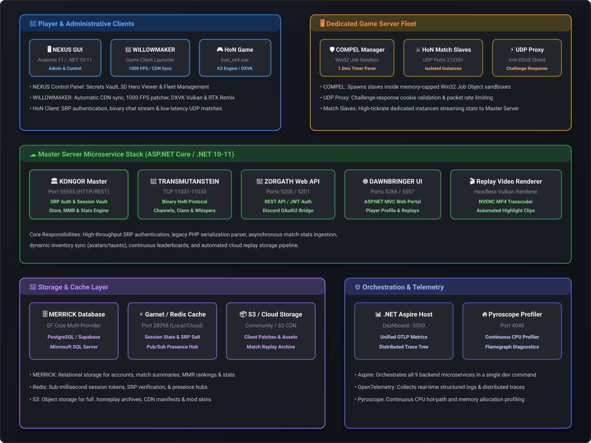

# 🏗️ ProjectKongor Ecosystem Architecture

ProjectKongor is architected across five distinct layers to provide maximum throughput, zero garbage collection stalls, sub-millisecond tick rates, and scalable cloud deployments.

---

## 🗺️ System Topology

---

## 1. 👤 Player & Administrative Clients
* **NEXUS Control Panel (`src/apps/control-panel`)**: Cross-platform desktop management interface built with Avalonia 11, featuring embedded 3D hero inspection and local secret vault management.
* **WILLOWMAKER (`src/apps/willowmaker`)**: Native game launcher automating CDN patch downloads, 1000 FPS engine unlocks, and DXVK Vulkan 1.3 injection.
* **HoN Game Client (`hon_x64.exe`)**: 64-bit K2 engine game client connecting via SRP authentication and low-latency UDP streams.

---

## 2. 🛡️ Dedicated Server Fleet (COMPEL)
* **COMPEL Fleet Manager (`src/apps/compel`)**: Direct dedicated server supervisor (`hon_x64.exe -dedicated -port {port} -pipe hon-server-{port}`). Manages isolated worker instances inside Win32 Job Object sandboxes with P-Core prioritized affinity, `timeBeginPeriod(1)` 1.0ms timer pacing, and granular per-worker crash recovery.
* **Dual-Channel Execution & In-Memory Streaming**: Direct synchronous write to worker `stdin` and dedicated Named Pipe IPC (`\\.\pipe\hon-server-{port}`), with zero-allocation `PipeReader` streams capturing stdout/stderr in memory.
* **Anti-DDoS UDP Proxy & Relay (`UDPForwarder`)**: Bidirectional UDP relay with bounded outbox channel serialization (`RunOutboxPumpAsync`), kernel buffer clamping (64 KB), lock-free atomic CAS token-bucket rate limiting (`UdpRateLimiter`), and RFC 8878 Zstandard entity delta compression (`ZstdDeltaCompressor`).

---

## 3. ☁️ Master Server Microservices (ASP.NET Core / .NET 11 — `net11.0`, see `global.json` / `Directory.Build.props`)
* **KONGOR Master Server (`src/services/master-server`)**: Central game coordinator featuring:
  - **Unified S2 Cryptography (`S2Crypto`)**: SRP-6a client/server authentication and chat cookie hashing.
  - **Decomposed 4-Stage Match Processing**: Discrete stages for ingestion/validation, economy rewards, Bayesian OpenSkill rating updates, and database persistence with explicit EF Core transaction boundaries (`BeginTransactionAsync` + `IExecutionStrategy`).
  - **Post-Commit Side Effects**: Isolated execution of Redis cache evictions, EventBus `MatchCompletedEvent` publishing, and cloud replay auto-upload queueing.
  - **Match Dead-Letter Queue**: In-memory ring buffer with FIFO eviction, forensic JSON crash dumping to `logs/dead_letter_matches/`, and programmatic replay facility (`ReplayJobAsync`).
  - **Protocol Resiliency**: Fallback handling for unhandled `server_requester.php` query functions, returning PHP serialized boolean false (`b:0;`) with HTTP 200 OK.
* **TRANSMUTANSTEIN Chat Server (`src/services/chat-server`)**: High-concurrency TCP binary chat server (Ports 11031–11033) with zero-copy `System.IO.Pipelines`.
* **ZORGATH Web Portal API (`src/services/web-api`)**: REST API with JWT authentication and Discord OAuth2 bridging.
* **DAWNBRINGER Web Portal UI (`src/services/web-ui`)**: ASP.NET MVC player portal for live match tracking, leaderboards, and replay streaming.
* **Replay Video Renderer (`src/extensions/replay-renderer`)**: Headless Vulkan frame capture pipeline with WASAPI audio loopback and FFmpeg NVENC MP4 encoding.

---

## 4. 💾 Storage & Caching Layer
* **MERRICK Database (`src/libs/database-context`)**: Entity Framework Core persistence supporting PostgreSQL 17, Supabase, and SQL Server.
* **Redis Cache**: Sub-millisecond session state caching, presence pub/sub, and lock management.
* **S3 / Cloud Storage**: S3-compatible cloud storage for match replay archives (`.honreplay`) and CDN game patch files.

---

## 5. ⚙️ Orchestration & Telemetry
* **.NET Aspire Host (`src/services/aspire-host`)**: Single-command cloud orchestration (`https://localhost:5550`) with OpenTelemetry distributed trace graphs.
* **Pyroscope**: Continuous CPU flamegraph profiling on port 4040.
* **Reverse Proxy Ingress Gateway**: RFC1918 private subnet CIDR validation (`10.0.0.0/8`, `172.16.0.0/12`, `192.168.0.0/16`) and `TRUST_ALL_PROXIES` edge proxy passthrough for Cloudflare, Envoy, and Docker container networks in `ServiceDefaults`.

---

## 6. 🛠️ Developer CLI & Headless Tooling
* **Kongor CLI (`src/tools/kongor-cli`)**: Lightweight (25 MB) developer and operator CLI powered by `Spectre.Console.Cli` command trees, cleanly decoupled from desktop UI packages.
* **Headless UI Renderer (`src/tools/headless-renderer`)**: Isolated offscreen Avalonia rendering tool (`kongor-render`) for automated UI capture and MCP visual inspection without polluting the CLI runtime footprint.

