# NEXUS Replay Studio — Deferred Future Work (Linux Docker K2 Client POV Recorder)

> **Status:** Deferred / Planned Future Work (Low-Frequency Staff Remote Moderation Feature)
> **Portal Visibility:** Greyed-out (`aria-disabled="true"`) inside the Staff-only navigation menu; inaccessible to non-staff users.

---

## 1. Purpose & Product Context

**NEXUS Replay Studio** is intentionally deferred as future work rather than shipping a browser-side 2D/canvas video approximation:

1. **Tactical 2D Playback Already Exists:** Every match detail page (`/matches/{matchId}`) and Learnatorium playback view already provides instant 60 FPS interactive 2D minimap replay, calibrated K2 terrain coordinates, skill upgrades, 6-slot item progression, and live action feeds.
2. **Authentic Moderation Requires Real K2 Client POV:** When a Staff moderator investigates griefing, camera/fog abuse, macros, or mechanical scripting, a synthetic 2D minimap video is insufficient—they need the **authentic 3D in-game camera, fog-of-war, cursor/order perspective, and combat HUD** rendered by the actual Heroes of Newerth / K2 game client from that specific player's point of view (POV).
3. **Target Use Case (Away-From-PC Staff Review):** When Staff members are at their home workstation, they can open `.honreplay` files directly in their local game client. Replay Studio is strictly intended as a **convenience fallback for scenarios where a Staff member is away from their home computer** (e.g., reviewing a moderation ticket from a laptop, tablet, or phone) and needs the backend to record a specific player's POV clip on their behalf. Because this scenario is low-volume and non-blocking for daily operations, the feature is marked as future work.

---

## 2. Recommended Target Architecture

Rather than re-implementing K2 world rendering in WebGL/Canvas, future implementation should orchestrate **real K2 game client instances inside ephemeral Linux Docker containers** coupled to an asynchronous background job worker.

```mermaid
flowchart LR
    Staff["Staff Moderator\n(Web Portal)"] -->|"1. Request POV Clip\n(MatchId + PlayerSlot + Window)"| API["Web Portal / Staff API\n(Job Queue in PostgreSQL/Redis)"]
    API -->|"2. Claim Render Job"| Worker["Background Replay Worker\n(Linux Docker Host)"]
    Worker -->|"3. Spawn Container +\nMount .honreplay"| Client["Headless K2 Game Client\n(Linux Docker: Wayland/Xvfb + Vulkan)"]
    Client -->|"4. Lock Camera to Player POV\n& Capture Audio/Video"| FFmpeg["Vulkan Capture / FFmpeg\n(NVENC / VAAPI / libx264 MP4)"]
    FFmpeg -->|"5. Upload Finished Clip"| Storage["Portal Object / Static Storage"]
    Storage -->|"6. Mark Ready & Stream"| Staff
```

### Stage-by-Stage Workflow

1. **Staff POV Request (Web Portal):**
   - From a Staff moderation report (`/staff`) or match detail page (`/matches/{matchId}`), an authenticated Staff member selects:
     - `matchId` (or uploads/selects the `.honreplay` archive)
     - `targetPlayerSlot` / `accountId` (the specific player whose perspective and fog-of-war will be recorded)
     - Optional time window (`startMatchTime`, `durationSeconds`, default full match or 2–5 minute incident window)
   - The portal inserts a `Queued` render job and immediately returns a job status card so the Staff member does not have to keep the tab open.

2. **Background Worker & On-Demand Linux Docker Orchestration:**
   - Because usage is infrequent, **no idle game client processes should stay resident in memory** when the queue is empty (`scale-to-zero` worker pool, concurrency `1`–`2`).
   - When a background daemon claims a `Queued` job, it stages the `.honreplay` archive into a read-only job volume and launches an isolated Linux Docker container containing:
     - The Linux K2 client runtime (or Wine/Proton x86_64 headless K2 client if matching Windows retail parity) mounted read-only against BYOA game archives on the host.
     - An isolated virtual display/compositor (`gamescope` headless, `Cage`/Wayland, or `Xvfb` + PulseAudio null sink for in-game audio).
     - Hardware Vulkan ICD (`/dev/dri` VAAPI or NVIDIA Container Toolkit NVENC when GPU is present, with Lavapipe/x264 ultrafast fallback only for non-GPU hosts).

3. **Automated Replay Playback & Player POV Lock:**
   - The container boots the client directly into replay playback mode (`+host_replay` / startup replay script) with deterministic console/Lua automation:
     - Waits for `gamePhase` transition into active replay world load.
     - Seeks to `startMatchTime` (minus a short 3-second pre-roll so particle states settle).
     - Locks spectator camera, selection, and fog-of-war perspective to `targetPlayerSlot` (`SpecLock` / player POV camera mode) with HUD enabled.

4. **Frame & Audio Recording + Portal Delivery:**
   - Either `VkLayer_hon_replay_capture` (zero-copy Vulkan `vkQueuePresentKHR` frame tap) or `gamescope`/FFmpeg captures 720p/1080p H.264/AAC `.mp4` (for universal mobile Safari + desktop browser compatibility).
   - When `endMatchTime` or `GAME_END` is reached, the client exits cleanly, the container is destroyed (`--rm`), and the worker uploads the `.mp4` artifact to portal storage and transitions the job to `Ready`.
   - The Staff member can then stream or scrub the recorded POV video directly inside the Staff Portal from any device.

---

## 3. Security, Licensing & Operational Guardrails

- **Staff-Only Access Control:** All Replay Studio routes, job queues, and rendered moderation videos must remain gated behind `StaffAuthorizationHelper.IsStaff(User)`. Regular player accounts must never be able to enqueue compute-heavy Docker jobs.
- **Cleanroom BYOA Boundary:** Never commit proprietary game binaries or `.s2z` archives into Dockerfiles or public Git repositories. Container images must build only cleanroom orchestration/capture harnesses and mount operator-supplied game assets at runtime via read-only host volumes.
- **Strict Resource Quotas & Timeouts:** Enforce container wall-clock timeouts (e.g., max `15` minutes per clip job), `--cpus` / `--memory` cgroup limits, `--network none` during replay playback (the replay file is already local, so zero outbound network access is needed inside the game container), and automatic TTL retention cleanup (e.g., purge rendered `.mp4` clips after `14` days unless pinned to an active ban appeal).

---

## 4. Current Codebase Touchpoints

| Component | Repository Path | Current State |
|---|---|---|
| Top Navbar & Mobile Menu | `src/services/web-ui/Views/Shared/_Layout.cshtml` | Rendered inside `@if (isStaffUser)` as a greyed-out disabled item (`aria-disabled="true"`, `Future` badge). |
| Staff Spec View | `src/services/web-ui/Views/Tools/ReplayStudio.cshtml` | Displays Staff-only future-work architectural notice and redirects interactive 2D analysis to `/matches`. |
| Job Queue & Upload Endpoints | `src/services/web-ui/Controllers/ToolsController.cs` | Existing Staff-gated job state & artifact upload endpoints retained as backend scaffolding for the future Linux Docker worker. |
| 2D Match Replay Engine | `src/services/web-ui/wwwroot/js/replay-player.js` | Production 2D tactical replay viewer active on `/matches/{matchId}`. |
