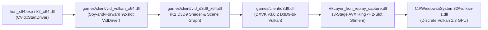

# K2 Vulkan Driver (`vid_vulkan_x64.dll`) and DXVK 3 (`v3.0.2`) Rendering Architecture

> [!IMPORTANT]
> Project Kongor runs **DXVK v3.0.2** (`games/client/d3d9.dll`, compiled with `x86_64 gcc 16.1.0`) in production alongside our custom `vid_vulkan_x64.dll` Spy-and-Forward driver and `VkLayer_hon_replay_capture.dll` implicit Vulkan layer. Never assume `hon_x64.exe` uses stock Windows `C:\Windows\System32\d3d9.dll`.

---

## 1. End-to-End Rendering & Capture Pipeline

When `hon_x64.exe` boots with `vid_driver "vid_vulkan"` (or `vid_d3d9`), the active runtime call chain inside `hon_x64.exe` is:

### Why `vid_vulkan_x64.dll` Uses the Spy-and-Forward Architecture
1. **Full K2 Shader & Fog-of-War Fidelity:** K2's HLSL shaders, fog-of-war textures, cliff normal maps, and UI modelpanels are compiled and managed through `vid_d3d9_x64.dll`.
2. **Native Vulkan 1.3 Execution via DXVK v3.0.2:** Because `games/client/d3d9.dll` is **DXVK v3.0.2**, every D3D9 call made by `vid_d3d9_x64.dll` is translated directly into Vulkan 1.3 command buffers using `VK_EXT_graphics_pipeline_library` (`dxvk.enableGraphicsPipelineLibrary = true`).
3. **Zero Redundant CPU Staging:** `vid_vulkan_x64.dll` intercepts `IDirect3DDevice9` vtable slots (`DrawIndexedPrimitive`, `DrawIndexedPrimitiveUP`, `Present`, `Reset`) exclusively to collect draw-call/batch/shader telemetry and guard against null resources—it does **not** duplicate vertex/index staging buffers on the CPU (`#257`), leaving all GPU buffer allocation to DXVK v3.0.2's `DxvkBuffer` slice allocator.

---

## 2. Key Files & Configuration

| File Path | Role | Notes |
| :--- | :--- | :--- |
| `games/client/d3d9.dll` | **DXVK v3.0.2** (`7,270,414 B`) | Local runtime DLL loaded by `vid_d3d9_x64.dll` ahead of `System32\d3d9.dll`. |
| `games/client/dxvk.conf` | DXVK v3.0.2 runtime config | Configures `d3d9.maxFrameRate = 144`, `dxvk.enableGraphicsPipelineLibrary = true`, `dxvk.enableLatencyReduction = true`, and `dxvk.numCompilerThreads = 6`. |
| `games/client/hon_x64_d3d9.log` | DXVK v3.0.2 startup & device log | Confirms `info: Game: hon_x64.exe`, `info: DXVK: v3.0.2`, Vulkan 1.3 GPU adapter, and applied `dxvk.conf` options. |
| [`native/drivers/vid_vulkan/src/vid_vulkan_spy.cpp`](../../native/drivers/vid_vulkan/src/vid_vulkan_spy.cpp) | `vid_vulkan_x64.dll` Spy-and-Forward entry | Wraps the 92-entry K2 `VidDriver` table and rotates `vid_vulkan_spy.log` $\to$ `vid_vulkan_spy.prev.log` on startup and at `16 MiB` (`#254`). |
| [`native/drivers/vid_vulkan/src/vulkan_3d.cpp`](../../native/drivers/vid_vulkan/src/vulkan_3d.cpp) | Telemetry & scene/model tracking | Tracks draw calls, triangle counts, models, and shaders without redundant CPU `memcpy` staging (`#257`). |
| [`native/vulkan-layer/frame_capturer.cpp`](../../native/vulkan-layer/frame_capturer.cpp) | `VkLayer_hon_replay_capture.dll` | Intercepts `vkQueuePresentKHR` below DXVK v3.0.2 to copy frames via a 3-stage AVX-aligned ring into `Local\KongorVulkanFrameRing`. |

---

## 3. Diagnostic Checklist for Vulkan & DXVK 3 Issues

1. **Verify DXVK v3.0.2 is active:** Check `games/client/hon_x64_d3d9.log` for `info: DXVK: v3.0.2` and `Vulkan: VK_EXT_graphics_pipeline_library`.
2. **Check `vid_vulkan_spy.log` rotation:** Verify `games/client/vid_vulkan_spy.log` stays bounded under `16 MiB` (`16,777,216 B`) with the previous session preserved in `vid_vulkan_spy.prev.log`.
3. **Measure Focused vs. Background Frame Pacing:** Windows 11 DWM + NVIDIA drivers throttle unfocused/minimized background swapchains to ~3 FPS (`~300 ms`). Always bring `hon_x64.exe` to the foreground (`SetForegroundWindow`) before measuring `frameTimeMs` (`p50` $\approx 6.94\text{ ms}$ at 144 FPS).
