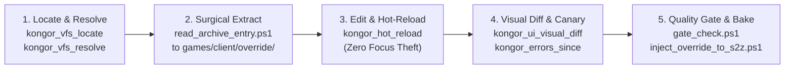

# 🎯 How-To: Surgical Client Override & VFS Workflow

> [!IMPORTANT]
> **The Golden Rule of Client Development:** `games/client/override/` is a **clean surgical workbench** (`0` permanent clutter files at baseline). Never extract entire `.s2z` archives into `override/`. Extract only the exact file you are actively editing, hot-reload it in $<50\text{ ms}$ via Zero-Focus-Theft Mailbox IPC, verify visually, and either commit directly or bake into `.s2z` with 5-tier `.bak` rotation.

---

## 🗺️ End-to-End 5-Step Workflow



---

## 🔎 Step 1: Locate & Check VFS Precedence (`VfsIndexService`)

The K2 engine mounts assets across a strict Virtual File System (VFS) hierarchy. Before editing or overriding any file, query the **in-memory `VfsIndexService`** (built into `kongor mcp`), which indexes the ZIP Central Directories of all `.s2z` archives (`resources0.s2z` through `resources999.s2z`, `textures.s2z`, map archives) and loose folders in sub-millisecond time:

### K2 VFS Mounting Precedence (Highest to Lowest)
1. **`games/client/override/`** *(Highest precedence — always wins, except against legacy `00000000/ui/...` entries in `textures.s2z`)*
2. **`games/client/base/`**
3. **`games/client/game/resources999.s2z` $\to$ `resources0.s2z`** *(Higher-numbered `.s2z` wins over lower-numbered `.s2z`)*
4. **`games/client/ClientPackageFiles/`** *(Plaintext UI source mirror)*
5. **`games/client/shared/`**
6. **`games/client/KONGOR/`**

### MCP Tool Commands
- **Search by filename or substring:**
  ```json
  // Tool: kongor_vfs_locate
  { "pattern": "store2.package" }
  ```
  Returns every `.s2z` archive and loose directory containing `store2.package`, along with byte sizes and timestamps.
- **Verify the active winning path:**
  ```json
  // Tool: kongor_vfs_resolve
  { "vfsPath": "/ui/fe2/store2.package" }
  ```
  Confirms which archive or folder currently wins in the K2 engine VFS stack.

---

## 🧪 Step 2: Surgically Extract Only the Target File into `override/`

Once `kongor_vfs_locate` identifies the winning `.s2z` archive (e.g. `games/client/game/resources0.s2z`), extract **only that single file** into `games/client/override/<vfs-subpath>` using [`scripts/vfs/read_archive_entry.ps1`](../../scripts/vfs/read_archive_entry.ps1):

```powershell
# Inspect or extract a single entry from an .s2z archive into games/client/override/
powershell -ExecutionPolicy Bypass -File scripts/vfs/read_archive_entry.ps1 `
    -ArchivePath "games/client/game/resources0.s2z" `
    -EntryPath "ui/fe2/store2.package" `
    -OutputPath "games/client/override/ui/fe2/store2.package"
```

> [!TIP]
> **Cross-Tree Mirror Parity:** If the file also exists in `games/client/ClientPackageFiles/<vfs-subpath>`, copy your finished edit there as well (`Copy-Item`) so `scripts/gate_check.ps1` verifies 100% byte-identical parity between `override/` and `ClientPackageFiles/`.

---

## ⚡ Step 3: Edit, Pre-Flight Lint & Live Hot-Reload (Zero Focus Theft)

1. **Edit the file** in `games/client/override/<path>` using IDE-native editing tools.
2. **Run Pre-Flight Syntax Verification:**
   ```powershell
   # Verify Lua 5.1 bytecode compilation (luac51.exe -p)
   powershell -ExecutionPolicy Bypass -File scripts/verify_client_lua.ps1 -Path "games/client/override/ui/fe2/store2.lua"

   # Verify K2 XML (.interface / .package / .entity) well-formedness
   powershell -ExecutionPolicy Bypass -File scripts/verify_xml_syntax.ps1 -Path "games/client/override/ui/fe2/store2.package"
   ```
3. **Hot-Reload Live in the Running Client (`hon_x64.exe`):**
   - Call `kongor_hot_reload` or `kongor_client_eval_lua` (`ReloadInterfaces()`).
   - **How Zero-Focus-Theft IPC Works:**
     - `CompositeGameIpcBridge` routes commands through **`NexusMailboxIpcBridge`** (`tao_req` / `tao_ack` CVar + file mailbox polled in Lua) and **`NativeClientIpcBridge`** (`\\.\pipe\KongorNativeGuard_*` inside `version.dll`, queued safely to the main-thread ring via `CConsole::AddCmdBuffer`).
     - The game reloads interfaces and executes Lua in $<50\text{ ms}$ in the background **without ever stealing OS window focus or interrupting your mouse/keyboard**.

---

## 📸 Step 4: Perceptual Visual Baseline Diffing & Canary Check

1. **Capture Before & After Screenshots:**
   - Use `kongor_capture_window` (background Win32 `PrintWindow` / Vulkan swapchain capture) before and after your change.
2. **Run Perceptual Visual Diff:**
   - Call `kongor_ui_visual_diff` or `kongor_assert_visual` to verify 0 unintended layout shifts, missing textures, or clipping.
3. **30-to-60 Second Canary Observation:**
   - Call `kongor_errors_since` and run `scripts/triage_client_logs.ps1` to confirm zero delayed Lua runtime errors (`ERR:` / `WARN:`) or missing texture loads in `console.log` and `client_lua_debug.log`.

---

## 🛡️ Step 5: Inner-Loop Quality Gate & On-Demand `.s2z` Injection

### 5.1 Run the Sub-5-Second Quality Gate
Before finishing any client task, run [`scripts/gate_check.ps1`](../../scripts/gate_check.ps1):

```powershell
powershell -ExecutionPolicy Bypass -File scripts/gate_check.ps1
```

`gate_check.ps1` enforces 4 tiers in under 5 seconds:
1. **Cross-Tree Lua/XML Parity (`Compare-Object`)** between `games/client/override/` and `games/client/ClientPackageFiles/`.
2. **Lua 5.1 Bytecode Syntax Check (`luac51.exe -p`)** across modified scripts.
3. **K2 XML Syntax & Footgun Audit** (rejects static `anim="idle"` on `<modelpanel>` and warns on unshadowable `textures.s2z` paths).
4. **32-Bit `.s2z` Archive Integrity Check** (verifies all `.s2z` archives stay under the 1.5 GB signed 32-bit offset limit).

### 5.2 Commit in `override/` OR Bake into `.s2z` On-Demand
- **Option A — Commit Directly in `override/`:**
  - `games/client/override/` is tracked by Git. `git commit` and `git push` **never** force archive injection or delete files from `override/`.
- **Option B — Bake into `.s2z` Archive (`scripts/vfs/inject_override_to_s2z.ps1`):**
  - When you are ready to graduate tested changes into `resources0.s2z` (or another target `.s2z`) and return `override/` to a 0-file clean slate:
    ```powershell
    # Dry-run preview first
    powershell -ExecutionPolicy Bypass -File scripts/vfs/inject_override_to_s2z.ps1 -DryRun

    # Perform non-destructive injection with 5-tier .bak rotation (.bak1 .. .bak5)
    powershell -ExecutionPolicy Bypass -File scripts/vfs/inject_override_to_s2z.ps1
    ```
  - **Instant Rollback:** Revert any injection at any time using [`scripts/vfs/revert_injected_override.ps1`](../../scripts/vfs/revert_injected_override.ps1).

---

## ⚠️ Critical K2 Engine UI & Rendering Footguns

1. **Unshadowable `textures.s2z` Legacy Paths (`00000000/ui/...`):**
   - `CResourceManager::RegisterTexture` gives legacy entries inside `games/client/game/textures.s2z` special internal precedence that can shadow identically named loose files in `override/`.
   - **Fix:** When replacing a UI texture that exists inside `textures.s2z`, use a **versioned basename** (e.g. `tab38_c.dds`) and update the corresponding `.package` / `.interface` reference.
2. **`<modelpanel>` Static `anim="idle"` Stutter:**
   - Setting `anim="idle"` as a static XML attribute on a `<modelpanel>` causes `CModelPanel::Frame` (`k2_x64.dll + 0x951020`) to call `CSkeleton::StartAnim` every tick, resetting `StartTime` to `Host.m_uiTime` ($\Delta t \equiv 0$) and freezing the model.
   - **Fix:** Always initialize animations via `onloadlua="self:SetAnim('idle')"` and `onshowlua="self:SetAnim('idle')"`, and set `scenebuffer="false"` unless an offscreen render-target blit is strictly required.
3. **WILLOWMAKER Startup Behavior (`WILLOWMAKER_SYNC_PACKAGE_FILES=0`):**
   - Launching the game via `WILLOWMAKER` (`kongor play`) automatically applies idempotent 1000 FPS binary patches (`EnginePatchService`) and `startup.cfg` rendering cvars (`RenderModernizationService`), while **leaving `games/client/override/` completely untouched** by default (`WILLOWMAKER_SYNC_PACKAGE_FILES=0`).
