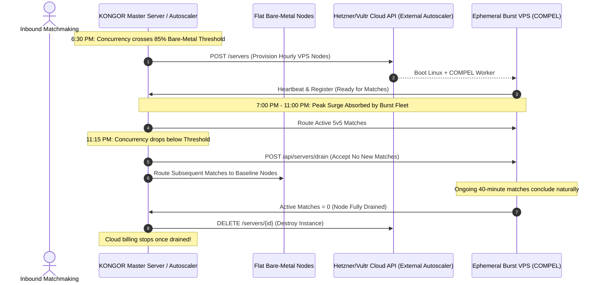
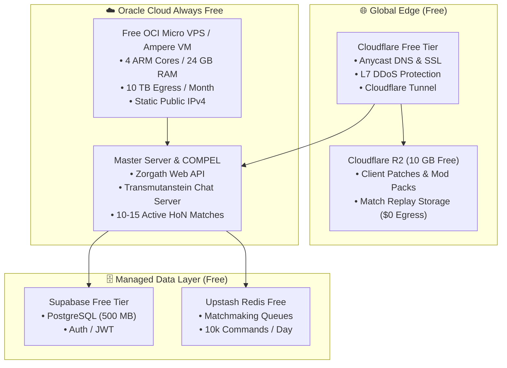

# 📊 Project Kongor: Host Estimation & Pricing Guide (2026)

<div align="center">

[]()
[]()
[]()
[]()

**A comprehensive, data-driven financial and architectural guide for hosting Project Kongor dedicated simulation servers from indie alpha ($0/mo) to global scale (1M+ CCU), with deep-dive analysis on the Bare-Metal to Hybrid inflection point.**

</div>

---

## 🧭 1. Executive Summary & Optimization Baseline

Hosting dedicated game servers historically represented the single largest recurring cost for competitive multiplayer titles. Traditional dedicated servers demand 1–2 GB RAM per instance and emit uncompressed entity state over UDP, incurring steep cloud computing and outbound internet egress bills.

Project Kongor overturns these economics through three fundamental engineering optimizations:

1. **Compact K2 Bit-Packed UDP Snapshots & Zstandard Proxy/Replay Compression**: 
   - Native `hon_x64.exe` game traffic uses K2's bit-packed entity delta snapshots, while COMPEL's managed UDP proxy relay and telemetry/replay pipelines apply RFC 8878 Zstandard compression (`ZstdDeltaCompressor`) to large payloads.
   - Bandwidth consumption averages **~15–25 kbps per player** (~25 KB/s for a 10-player 5v5 match).
   - An entire 40-minute match consumes only **~50–60 MB total egress**.
2. **Headless Zero-Rendering Simulation Footprint**:
   - Graphical rendering, audio mixing, and UI layers are stripped from `hon_x64.exe -dedicated`.
   - Dedicated worker processes consume only **~180–200 MB RAM** per active match.
3. **COMPEL Process Supervisor & Micro-Pacer**:
   - Replaces heavy container engines with native Win32 Job Objects and Linux Cgroups v2.
   - Microsecond pacing (`timeBeginPeriod(1)` and high-resolution multimedia timers) provides sub-millisecond tick precision with zero intermediate virtual network latency.

$$\text{Egress per 40-min Match} = 10\text{ players} \times 20\text{ kbps} \times 2400\text{ sec} \approx \mathbf{60\text{ MB}}$$

---

## ⚡ 2. The Core Decision: When to Switch from Pure Bare-Metal to Hybrid

The most critical architectural decision in game operations is knowing **when** to abandon pure bare-metal and transition to a **Hybrid Architecture (Flat Bare-Metal Baseline + Cloud Bursting)**. 

Transitioning too early adds unnecessary API complexity for negligible savings; transitioning too late wastes tens of thousands of dollars on idle bare-metal hardware during off-peak hours.

```
Monthly Spend ($)
   ▲
   │                                        / Pure Cloud (AWS/GCP Agones) [Highest Cost]
   │                                       /
   │                                      /
   │                                     /      / Pure Bare-Metal (Flat 24/7) [Idle Waste]
   │                                    /      /
   │                                   /      /
   │                                  /      /
   │                                 /     ┌──────── ★ THE HYBRID CROSSOVER POINT
   │                                /      │         (5,000 – 10,000 CCU)
   │                               /      /
   │                              /     ┌┴──────────────── Hybrid (Bare-Metal Base + Burst VPS)
   │                             /     /                   [Lowest Operational Cost]
   │                            /    /
   │                           /   /
   │                          /  /
   │  [Free Tier / VPS]     / /
   └────────────────────────┴─────────────────────────────────────────► Concurrent Players (CCU)
    0                     1k        5k       10k       50k       100k
```

### The 4 Golden Trigger Indicators (When to Switch)

Switch from Pure Bare-Metal to Hybrid when your telemetry crosses these thresholds:

| Trigger Indicator | Pure Bare-Metal Zone | 🚨 Transition Window (Switch to Hybrid) | Hybrid Optimum Zone |
|---|---|---|---|
| **Peak Concurrent Users (CCU)** | 100 – 5,000 CCU | **5,000 – 10,000 CCU** | 10,000 – 1,000,000+ CCU |
| **Monthly Dedicated Hardware Spend** | < $500 / month | **$1,000 – $2,000 / month** | $2,000+ / month |
| **Diurnal Peak-to-Trough Ratio** | < 2.0x (Flat play patterns) | **$\ge 2.5\times$ (Evening spikes)** | $\ge 3.0\times$ (Heavy evening concentration) |
| **Event / Weekend Surge Multiplier** | Normal minor variance | **2.0x – 3.0x on tournament weekends** | Massive weekend & patch surges |

#### 1. The Financial Threshold ($1,000/mo Rule)
* **Under 5,000 CCU**: 4 to 10 dedicated bare-metal servers cost **$200 to $500/month**. At this price, engineering automated dynamic cloud spin-up/spin-down scripts only saves ~$60–$100/mo. The operational simplicity of leaving machines running 24/7 outweighs the minor savings.
* **Above 5,000 CCU**: Hardware bills exceed **$1,500 to $2,500/month**. Over-provisioning for evening peak means you are paying for 30+ servers that sit completely idle for 16 hours a day. The hybrid model immediately saves **$800 to $1,500+ every single month**.

#### 2. The Diurnal Ratio Trigger (Peak-to-Trough $\ge 2.5\times$)
In gaming, player concurrency forms a diurnal wave (peaking from 7:00 PM to 11:00 PM and plummeting from 3:00 AM to 8:00 AM). 
* If your peak is 20,000 players and your night valley is 6,000 players, your ratio is **$3.33\times$**. 
* Sizing pure bare-metal for 20,000 means **70% of your dedicated fleet is burning electricity doing nothing for 18 hours a day**.

---

### Case Study: Financial Proof at 20,000 Peak CCU (2,000 Matches)

Here is the exact cost comparison demonstrating why the switch to Hybrid saves **57%** at scale:

| Metric | Option A: Pure Bare-Metal (Flat 24/7) | Option B: Hybrid (Bare-Metal Base + Burst VPS) |
|---|---|---|
| **Sizing Strategy** | 50 Dedicated AMD Ryzen boxes provisioned for 24/7 peak | **18 Dedicated Ryzen boxes** (baseline) + **52 Cloud VPS** (burst) |
| **Baseline Cost (Off-Peak & Day)** | 50 boxes $\times$ $50/mo = **$2,500 / month** | 18 boxes $\times$ $50/mo = **$900 / month** |
| **Burst Cost (4.5 hrs/day Peak)** | $0 (Included in flat rate) | 52 VPS $\times$ 4.5 hrs/day $\times$ 30 days $\times$ $0.025/hr = **$175.50 / month** |
| **Monthly Transit / Bandwidth** | Unmetered (Included) | Included in Hetzner/Vultr VPS quota |
| **Total Monthly Infrastructure** | **$2,500.00 / month** | **$1,075.50 / month** |
| **Annual Infrastructure Bill** | **$30,000 / year** | **$12,906 / year** |
| **Net Operational Savings** | Baseline | **Save $17,094 / year (-57.0%)** |

---

### Reference Architecture: Hybrid Drain & Terminate with COMPEL

The reason traditional game studios struggle with hybrid models is the **Kubernetes "Bin-Packing" Flaw** (where cloud instances cannot shut down if even one 40-minute match is running).

COMPEL supports a **Drain & Terminate** lifecycle via `GracefulDrainCoordinator` (`POST /api/servers/drain`) and `AgonesSdkService` that external cloud autoscalers (e.g., Hetzner Cloud or Vultr webhooks/cron scripts) can drive:



1. **Predictive Scaling (6:30 PM)**: As regional matchmaking velocity accelerates, an external autoscaler can call the cloud provider API (Hetzner Cloud or Vultr) to provision lightweight VPS nodes at **€0.007 to €0.022 / hour**.
2. **Priority Match Routing**: New matches are assigned to the burst nodes, keeping the flat bare-metal nodes running at a steady baseline load.
3. **Graceful Drain (11:15 PM)**: When the peak begins to subside, the autoscaler calls COMPEL's `POST /api/servers/drain` endpoint (`GracefulDrainCoordinator`). No new matches are scheduled on drained workers while active 40-minute games complete naturally.
4. **Instance Teardown**: Once `ActiveMatches == 0` on a drained burst node, the autoscaler can destroy the cloud instance via the provider's API so cloud compute is billed only for the active peak window.

---

## 💰 3. Master Hosting Estimation Matrix (2026)

In multiplayer game operations, infrastructure is provisioned against **Concurrent Connected Users (CCU)**—the peak number of players actively playing simultaneously. Peak CCU is typically **5% to 10%** of **Monthly Active Users (MAU)**.

| Player Tier (Peak CCU) | Monthly Active Players (MAU) | Concurrent Matches (5v5) | Recommended Infrastructure Strategy | Monthly Cost (Flat 24/7) | Monthly Cost (Real-World Diurnal)* | Cost Per Active Player / Mo |
|---|---|---|---|---|---|---|
| **< 100** | Up to 1,500 | 1 – 10 | **Oracle Cloud Always Free Tier** | **$0.00** | **$0.00** | **$0.00** |
| **101 – 1,000** | 1,500 – 15,000 | 10 – 100 | **Multi-Region VPS Fleet** (Hetzner + Vultr) | **$18 – $35** | **$12 – $22** | ~$0.0015 |
| **1,001 – 5,000** | 15,000 – 75,000 | 100 – 500 | **Pure Bare-Metal Fleet** (AMD Ryzen 7 7700) | **$90 – $160** | **$90 – $160** | ~$0.0018 |
| **5,001 – 10,000** | 75,000 – 150,000 | 500 – 1,000 | 🚨 **THE HYBRID CROSSOVER POINT** (Base + Burst) | **$250 – $350** | **$160 – $220** | ~$0.0017 |
| **10,001 – 100,000** | 150,000 – 1.5M | 1,000 – 10,000 | **Hybrid Fleet** (25–30 Bare-Metal + Burst VPS) | **$2,200 – $3,200** | **$1,400 – $2,100** | ~$0.0019 |
| **100,001 – 500,000** | 1.5M – 7.5M | 10,000 – 50,000 | **Multi-Datacenter Leased Racks** (OVH / Leaseweb) | **$12,000 – $18,000** | **$8,000 – $12,000** | ~$0.0020 |
| **500,001 – 1,000,000** | 7.5M – 15M | 50,000 – 100,000 | **Dedicated Transit + Global Colocation Racks** | **$30,000 – $45,000** | **$22,000 – $32,000** | ~$0.0025 |
| **1,000,000+** | 15M – 30M+ | 100,000+ | **Custom BGP Anycast & Direct Transit Peering** | **$55,000 – $80,000+** | **$45,000 – $65,000+** | ~$0.0030 |

*\*Real-world diurnal estimates reflect the hybrid model where evening peak compute is provisioned dynamically.*

---

## 🆓 4. The 100% Free Launch Tier ($0/Month)

For closed testing, alpha releases, and early beta access (< 100 CCU / 1,500 MAU), the entire ecosystem runs at **zero recurring cost**:



### Free Tier Allocation Matrix

| Service Component | Provider & Tier | Quota Included | Role in Project Kongor |
|---|---|---|---|
| **Compute & Game Fleet** | **Oracle Cloud Always Free** | 4 Ampere OCPUs, 24 GB RAM | Runs Master Server, Chat Server, and 10–15 concurrent 5v5 matches. |
| **Egress Bandwidth** | **Oracle Cloud Always Free** | **10,000 GB (10 TB) / month** | Covers **~165,000 full 40-minute matches** without overage charges. |
| **DNS, SSL & WAF** | **Cloudflare Free Tier** | Unlimited HTTP/HTTPS | Manages domain DNS, wildcard SSL termination, and L7 web defense. |
| **Client Patches & Replays** | **Cloudflare R2** | 10 GB storage, $0 Egress | Distributes game updates, hero textures, and match replays. |
| **Primary Database** | **Supabase Free Tier** | 500 MB PostgreSQL | Stores player accounts, matchmaking MMR, hero stats, and match summaries. |
| **Session Cache & Queues**| **Upstash Redis Free** | 10,000 commands / day | Handles real-time matchmaking tickets and distributed player session locks. |

---

## 🥊 5. Architectural Comparison: COMPEL vs. K3s + Agones

Many game studios adopt **Kubernetes (K3s) + Google Agones** for game server orchestration. Below is an engineering and economic comparison between our native **COMPEL Supervisor** and **K3s + Agones** across both cloud auto-scaling and self-hosted bare-metal environments.

### Sizing & Cost Comparison Table

| Player Tier (Peak CCU) | COMPEL on Bare-Metal / VPS | K3s + Agones (On Bare-Metal Dedicated) | K3s + Agones (Cloud Auto-Scaled: AWS/GCP) |
|---|---|---|---|
| **< 100** | **$0.00 / mo** (Free Tier) | **$25 – $45 / mo** | **$120 – $180 / mo** |
| **101 – 1,000** | **$18 – $35 / mo** | **$70 – $110 / mo** | **$280 – $450 / mo** |
| **1,001 – 10,000** | **$160 – $220 / mo** | **$340 – $550 / mo** | **$2,500 – $3,800 / mo** |
| **10,001 – 100,000** | **$1,400 – $2,100 / mo** | **$3,800 – $5,400 / mo** | **$26,000 – $38,000 / mo** |
| **100,001 – 500,000** | **$8,000 – $12,000 / mo** | **$19,000 – $27,000 / mo** | **$130,000 – $190,000 / mo** |
| **500,001 – 1,000,000** | **$22,000 – $32,000 / mo** | **$48,000 – $68,000 / mo** | **$320,000 – $480,000 / mo** |
| **1,000,000+** | **$45,000 – $65,000+ / mo** | **$85,000 – $120,000 / mo** | **$650,000 – $950,000+ / mo** |

### Why Agones Costs More Even on Bare Metal

1. **The 35% Pod Memory & CPU Tax**:
   - Every Agones match Pod requires an `agones-sdk` sidecar, pause container, cgroup hierarchy, and virtual ethernet interface (`veth`), consuming ~350–400 MB per match (vs. ~180–200 MB under COMPEL).
   - On an identical 64 GB Ryzen server, **COMPEL packs ~55 matches** while **Agones packs ~35 matches**.
2. **The 20% Warm Pool Standby Tax**:
   - Agones requires maintaining a pre-warmed pool of running Pods (`Allocatable`) to avoid 15–30 second container initialization delays during match dispatch.
   - COMPEL boots an isolated native game process in **~180 milliseconds**, achieving zero-buffer on-demand dispatch.
3. **Multi-Region etcd Latency Barriers**:
   - Kubernetes Raft/etcd consensus cannot bridge transatlantic latency (80–120ms ping causes quorum timeouts). Running Agones globally requires provisioning and maintaining **separate independent Kubernetes clusters** in every single region.

---

## 🗺️ 6. Phased Operational Roadmap

### Phase 1: Closed Testing & Community Alpha (< 100 CCU)
- **Architecture**: **Free Tier Mode**.
- **Budget**: **$0.00 / month**.
- **Setup**: Oracle Cloud Always Free (US-East Ashburn) running Master Server and COMPEL.
- **Edge**: Cloudflare Free (DNS, SSL, Cloudflare Tunnel).
- **Storage**: Supabase Free (PostgreSQL) + Upstash (Redis).

### Phase 2: Public Beta & Regional Expansion (100 – 1,000 CCU)
- **Architecture**: **Pure VPS Mode**.
- **Budget**: **$18 – $35 / month**.
- **Setup**: 4-region VPS fleet (Hetzner US-East, Hetzner US-West, Hetzner Europe, Vultr Asia-Pacific). Simple fixed VPS nodes; no dynamic scaling scripts needed.

### Phase 3: Commercial Launch & Growth (1,000 – 5,000 CCU)
- **Architecture**: **Pure Bare-Metal Mode**.
- **Budget**: **$90 – $160 / month**.
- **Setup**: 2 to 3 dedicated AMD Ryzen 7 7700 servers in primary demographic regions. Flat-rate billing eliminates all burst API complexity while keeping hosting under $160/mo.

### Phase 4: Enterprise Scale (5,000 – 100,000+ CCU)
- **Architecture**: 🚨 **THE HYBRID SWITCH (Baseline Bare-Metal + Cloud Burst)**.
- **Budget**: **$1,400 – $2,100 / month** (Saves ~57% vs $3,200+ pure bare-metal).
- **Setup**: 15–20 core bare-metal dedicated servers anchored in major hubs + automated COMPEL Cloud API burst workers dynamically provisioned during local 7:00 PM – 11:30 PM peak windows.

---

## 📚 Related Documentation
- [VPS Gateway Hosting Guide](vps-hosting-guide.md)
- [Container Hosting Guide](container-hosting-guide.md)
- [Network Ports & IPC Protocol Matrix](network-and-ports.md)
- [COMPEL Architecture & Application Guide](../../src/apps/compel/README.md)
