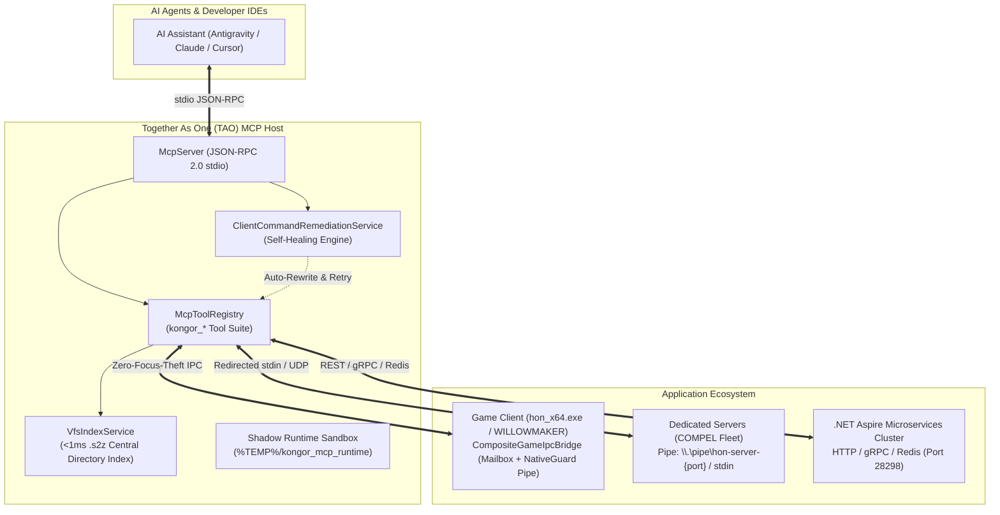
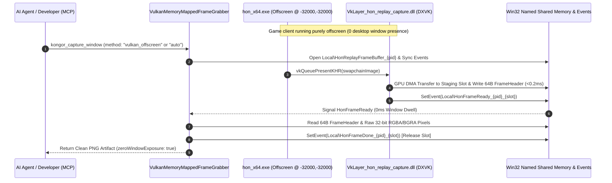
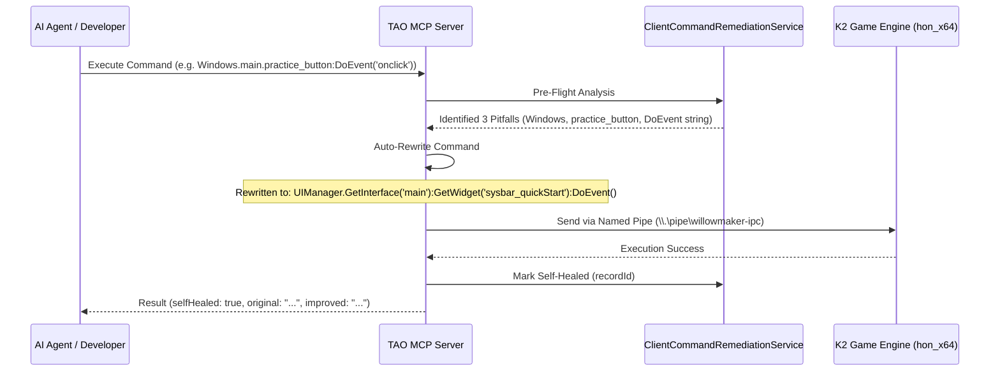

# 🌸 Together As One (TAO) — KONGOR MCP Server

> *"We Are As One"*  
> — **Empath**, *Heroes of Newerth*

<div align="center">

[](https://modelcontextprotocol.io/)
[](#-the-mcp-tools-catalog)
[](#-the-self-healing-architecture--remediation-loop)
[](#-system-architecture--how-tao-attaches)
[](#-clean-room--git-lfs-workspace-statement)

</div>

> [!TIP]
> **TAO MCP Documentation Hub**: For agent setup guides (Claude, Copilot, Cursor, Antigravity), 1-click install scripts, and the complete tool reference catalog, visit [`docs/tao-mcp/`](README.md):
> - [`instructions.md`](instructions.md) — Universal Agent Integration Guide.
> - [`tools-catalog.md`](tools-catalog.md) — Complete Tool Reference Catalog.
> - [`self-healing.md`](self-healing.md) — Autonomous Self-Healing Triangulation.

---

## ⚖️ Clean-Room & Git LFS Workspace Statement

> [!IMPORTANT]
> 1. **Original Authorship & License (`AGPL-3.0-or-later`)**: **TAO (Together As One) MCP Server** was created by **`guccidonut`** for **Project KONGOR V (`PKV`)** (<https://github.com/guccidonut/PKV>) and is licensed under `AGPL-3.0-or-later` (with author attribution preserved pursuant to `AGPL-3.0` Section 7(b) — see [`../../NOTICE`](../../NOTICE) and [`../../CITATION.cff`](../../CITATION.cff)).
> 2. **Cleanroom Bring-Your-Own-Assets (BYOA) Workspace**: Public GitHub clones ship **zero** `.s2z` archives, textures, models, or engine binaries (`0` Git LFS dependencies). Developers who mount their own lawfully obtained *Heroes of Newerth* installation under `games/client/` (or via `scripts/vfs/Hydrate-LocalGameAssets.ps1`) unlock live in-engine MCP attach and VFS inspection.
> 3. **Sub-Millisecond Virtual File System (`VfsIndexService`)**: The TAO MCP Server indexes the ZIP Central Directories of all local `.s2z` archives (`resources0.s2z` through `resources999.s2z`, `textures.s2z`) in memory, enabling sub-millisecond asset lookup (`kongor_vfs_locate`, `kongor_vfs_resolve`, `kongor_vfs_mount_graph`) and surgical single-file overrides in `games/client/override/`.

---

## 📖 The Philosophy: The Empath Analogy

In *Heroes of Newerth*, **Empath** is the definitive empathetic guardian. When the teamfight turns chaotic, Empath channels her signature ultimate ability: **Together As One (TAO)**. She literally **hops into the body of her allied carry**. 

```
  ┌───────────────────────────────────────────────────────────┐
  │                   HEROES OF NEWERTH LORE                  │
  │                                                           │
  │     [ Empath ] ───( Together As One )───► [ Allied Hero ] │
  │                                                           │
  │         • Grants Movement Speed & Attack Speed            │
  │         • She Heals From Inside                           │
  │         • Casts Spells Sympathetically from Within        │
  └───────────────────────────────────────────────────────────┘
```

Once inside, Empath does not simply observe from the sidelines. She amplifies the host's physical attributes, heals damage from within, and fires supportive abilities in perfect synergy with the host.

### How TAO Operates in ProjectKongor

This is the exact design philosophy of **TAO (Together As One)** in ProjectKongor. Instead of being an external tool that blindly fires commands from afar, **TAO hops directly into the application**:

```
  ┌──────────────────────────────────────────────────────────────────────────────┐
  │                       PROJECTKONGOR TAO ARCHITECTURE                         │
  │                                                                              │
  │     [ TAO MCP Server ] ───( Mailbox & NativeGuard IPC )────► [ Runtime App ] │
  │                                                                     │        │
  │         • Observes Internal Engine State & Telemetry                │        │
  │         • Intercepts & Rewrites Malformed Calls (Self-Healing)      │        │
  │         • Sandboxes Dedicated Servers & Client Processes            │        │
  │         • Dispatches Commands via Zero-Focus-Theft Mailbox IPC      │        │
  └──────────────────────────────────────────────────────────────────────────────┘
```

When an AI assistant (such as Antigravity, Claude, or Cursor) or a human developer interacts with ProjectKongor through TAO:
1. **TAO attaches** to the game client (`hon_x64.exe`), dedicated servers (`COMPEL`), and backend microservices (`Aspire Host`, `Master Server`).
2. **TAO gives the application a boost**: it unlocks 1000 FPS frame rates, injects offscreen rendering buffers, indexes `.s2z` VFS mounts via `VfsIndexService`, and coordinates multi-agent bot choreography.
3. **TAO self-heals**: If a script errors out, if a UI element name has changed, if a CVar is read-only, or if a global table reference is invalid, TAO steps in, analyzes the root cause, rewrites the syntax, and transparently retries the operation to keep development moving forward.

---

## 🏛️ System Architecture: How TAO Attaches

TAO runs as a native .NET 11 JSON-RPC 2.0 server (`Kongor.Cli.Mcp`) over standard input/output (`stdio`), bridging developer tools to in-engine runtimes via low-latency local channels.



### 1. Zero-Lock Shadow Runtime
When running inside modern IDEs, background MCP servers often lock `.dll` and `.exe` files, preventing developers from running `kongor build` or `dotnet build`. TAO solves this with **Automatic Shadow Execution**:
- On boot, TAO copies the active binaries into `%TEMP%\kongor_mcp_runtime\pid_<PID>`.
- The MCP server executes entirely from the shadow directory.
- Developers can recompile code in real time without killing their active AI pair-programming session.

### 2. Windows Job Object Teardown Guard
Child game and server processes spawned by TAO are assigned to a **Win32 Job Object** with `JOB_OBJECT_LIMIT_KILL_ON_JOB_CLOSE`. When the IDE, terminal, or MCP server closes, all associated game client and server processes terminate cleanly with **zero orphan processes left behind**.

### 3. Zero-Focus-Theft Client IPC (`CompositeGameIpcBridge`) & Dedicated Server Routing
To guarantee command delivery without ever stealing OS window focus or interfering with player keyboard/mouse input:
- **Game Client (`CompositeGameIpcBridge`)**:
  - **`NexusMailboxIpcBridge`**: Exchanges structured Lua/console commands and responses through the in-engine CVar/file mailbox (`tao_req` / `tao_ack`) with `FileShare.ReadWrite` retry resilience.
  - **`NativeClientIpcBridge`**: Connects to `\\.\pipe\KongorNativeGuard_*` inside `version.dll` (NativeGuard), queuing commands directly onto the K2 main-thread command ring (`CConsole::AddCmdBuffer`).
  - **`WillowmakerIpcBridge`**: Coordinates launcher state over `\\.\pipe\willowmaker-ipc`.
- **Dedicated Servers**: Commands route either through redirected `stdin` streams or port-specific named pipes (`\\.\pipe\hon-server-{port}`). Commands targeting dedicated servers **must include the specific target listen port (e.g. `port: 11235`)**; broadcasting to generic pipes is blocked.

---

## 🛠️ The MCP Tools Catalog

TAO equips AI agents and developers with **specialized tools** grouped into functional handler domains:

### 1. 🎮 Client Lifecycle & Runtime Management
| Tool Name | Key Arguments | Capabilities |
|---|---|---|
| `kongor_game_client_manage` | `action: "launch" \| "status" \| "stop" \| "restart" \| "errors"` | Manages the `hon_x64.exe` client process, detects window state, and queries remediation error buffers. |
| `kongor_game_command` | `command`, `target: "client" \| "server" \| "both"`, `port` | Dispatches native K2 engine commands and CVars via Named Pipe IPC with automatic self-healing. |
| `kongor_game_client_command` | `command`, `autoLaunch`, `timeoutMs` | Dedicated execution channel targeting the player game client console. |
| `kongor_game_lua` | `code`, `action: "eval" \| "exec"`, `autoLaunch` | Evaluates Lua code in the live game client interface with syntax pre-checks and sandbox wrapping. |
| `kongor_game_manage` | `action: "start" \| "stop" \| "restart"` | High-level lifecycle controller for player client instances. |
| `kongor_game_telemetry` | `timeoutMs` | Reads live client metrics: instantaneous FPS, frametime percentiles, memory working set, and player counts. |
| `kongor_game_action` | `action: "ping" \| "state"` | Performs low-overhead health pings against the client IPC bridge. |
| `kongor_willowmaker_manage` | `action: "status" \| "apply_patches"` | Inspects WILLOWMAKER 1000 FPS pacer status, DXVK Vulkan hooks, and CDN delta manifests. |

### 2. 🛡️ Dedicated Server Fleet & Match Orchestration
| Tool Name | Key Arguments | Capabilities |
|---|---|---|
| `kongor_game_server_manage` | `action: "start" \| "stop" \| "restart" \| "status"`, `port`, `map` | Supervises host & Docker (`kongor-stack`) COMPEL dedicated server workers across Tier D (`:11334`) and Tier Q (`:11484`). |
| `kongor_game_server_command` | `port`, `command`, `timeoutMs` | Dispatches authoritative console commands directly to a specific dedicated server listen port (`port: 11235` or `11335`). |
| `kongor_server_manage` | `action: "start" \| "stop" \| "status"`, `service: "aspire" \| "docker" \| "compel" \| "all"` | Controls the .NET Aspire microservices cluster, turnkey `kongor-stack` Docker stack, and server infrastructure. |
| `kongor_server_perf_stream` | `action: "snapshot" \| "stream"`, `port` | Sub-second telemetry streaming for server tickrates (50Hz/100Hz), packet loss, and CPU load. |
| `kongor_compel_manage` | `action: "status" \| "scale"`, `targetInstances` | Queries or scales active host & Docker COMPEL worker pools (`:11234`, `:11334`, `:11484`) and multimedia timer pacing. |
| `kongor_match_launch` | `mode: "practice" \| "bot" \| "public"`, `map`, `hero` | Launches matches directly bypassing complex multi-step UI clicks. |
| `kongor_client_practice` | `hero`, `map`, `window_mode: "offscreen" \| "windowed"` | Launches automated practice sessions with instant hero spawning. |
| `kongor_scrimmage_launch` | `map`, `team1Heroes`, `team2Heroes` | Orchestrates 5v5 scrimmages between autonomous bots for balance testing. |
| `kongor_matchmaking_simulate` | `playerCount`, `skillSpread` | Simulates high-load matchmaking queues to verify PSR/MMR Elo algorithms and lobby assignment. |
| `kongor_match_state` | `port` | Queries authoritative match state: game time, towers remaining, team gold, and player inventories. |
| `kongor_match_simulate_e2e` | `port`, `fastSimulation`, `durationSeconds` | Runs end-to-end simulated matches at uncapped speed to verify game-ending victory conditions. |
| `kongor_match_spectator` | `port`, `action: "attach" \| "detach" \| "telemetry"` | Attaches an authoritative spectator bridge to stream match tick events. |

### 3. 🖼️ UI Automation, Navigation & Headless Rendering
| Tool Name | Key Arguments | Capabilities |
|---|---|---|
| `kongor_k2_ui_inspect` / `kongor_ui_inspect` | `path: "main" \| "store" \| "hero_select"` | Dumps the live XML/Lua widget hierarchy, resolving widget names, coordinates, and visibility flags. |
| `kongor_client_navigate` | `destination: "store" \| "hero_select" \| "main_menu" \| "options"` | Programmatically navigates game interfaces via clean engine Lua triggers without mouse cursor simulation. |
| `kongor_ui_control` | `action: "click" \| "type" \| "dismiss_console"`, `target` | Dispatches deterministic UI interactions while strictly guarding against chat-focus input spills. |
| `kongor_ui_flow` | `action: "record" \| "play" \| "history"` | Sequences multi-step UI flows (e.g. Navigating from Main Menu -> Goblin Store -> Avatar Preview). |
| `kongor_ui_observer` | `action: "wait_visible"`, `widget`, `timeout_ms` | Reactive K2 UI observer that waits asynchronously for widget visibility without CPU spinning. |
| `kongor_ui_render_view` | `view_name`, `save_artifact` | Headless offscreen XAML/UI view rendering using Avalonia Headless and SkiaSharp. |
| `kongor_ui_visual_diff` | `baselineImage`, `candidateImage`, `threshold` | Calculates SSIM visual similarity and renders color-coded pixel diff artifacts. |
| `kongor_assert_visual` | `expectedPattern`, `region`, `threshold` | Asserts UI visual rendering conditions against headless frame captures. |
| `kongor_capture_window` | `target`, `capture_method: "auto" \| "vulkan_offscreen" \| "print_window" \| "window_dc" \| "desktop_dc" \| "transient"`, `save_artifact` | Captures window screenshots with Tier 0 Vulkan swapchain shared memory acceleration (0ms dwell, zero exposure), cascading gracefully to PrintWindow, Window DC, and Desktop DC. |
| `kongor_transient_capture` | `target`, `dwell_ms`, `width`, `height`, `save_artifact` | Momentary headless capture. Automatically intercepted by Tier 0 Vulkan shared memory when available (0ms dwell, zero window exposure). Falls back to momentary (0, 0) exposition if inactive. |

### 4. 📦 Virtual Filesystem (VFS), Modding & Asset Pipeline
| Tool Name | Key Arguments | Capabilities |
|---|---|---|
| `kongor_vfs_resolve` | `virtualPath` | Resolves virtual paths (e.g. `/ui/main.interface`) to physical paths across stacked `.s2z` archives. |
| `kongor_vfs_locate` | `query`, `extension` | Fast glob search locating files across all active VFS mount roots and archives. |
| `kongor_vfs_mount_graph` | `action: "inspect_mounts"` | Analyzes mount precedence, shadowing order, and overlay conflicts in the K2 Virtual File System. |
| `kongor_asset_inspect` | `path: "game/resources0.s2z"` | Inspects `.s2z` ZIP central directory headers, compression ratios, and CRC32 checksums. |
| `kongor_asset_bake_pipeline` | `action: "bake" \| "clean"`, `targetPath` | Multi-threaded asset baking converting models, clips, and materials into optimized runtime formats. |
| `kongor_audio_studio` | `action: "preview" \| "synthesize"`, `hero`, `cue` | In-engine audio auditioning and voice synthesis pipeline verification. |
| `kongor_engine_cache_purge` | `target: "entities" \| "lua" \| "all"` | Invalidates and flushes MemoryPack and Zstd prebaked binary caches. |
| `kongor_cache_coherence_verify`| `action: "verify"` | Validates binary cache checksums against raw XML entity definitions to detect drift. |
| `kongor_mod_build` | `sourceDirectory`, `outputArchive` | Compiles loose assets and mod scripts into production `.honmod` or `.s2z` packages. |
| `kongor_material_inspect` | `path: "sample.material"` | Parses K2 material shaders, texture samplers, blend modes, and culling states. |
| `kongor_texture_preview` | `path: "sample.dds"`, `save_artifact` | Decodes DirectX DDS/TGA textures into web-compatible PNG/JPEG artifacts for visual review. |
| `kongor_texture_in_game_inspect`| `hero: "Hero_Pyromancer"` | Verifies texture binding and mipmap resolution directly on in-game hero models. |
| `kongor_texture_diff` | `baseline`, `candidate`, `threshold` | Detects texture artifacting and compression degradation. |
| `kongor_audio_preview` | `soundPath`, `action: "status"` | Validates K2 sound definitions, sample rates, spatial rolloff, and event hooks. |

### 5. 🧠 Engine Introspection, Dynamic Memory & Hot-Reload
| Tool Name | Key Arguments | Capabilities |
|---|---|---|
| `kongor_engine_inspect` | `target: "cvar" \| "cmd"`, `query` | Searches and inspects engine cvars, default values, and command symbol tables. |
| `kongor_app_eval` | `script: "C# Roslyn Expression"` | Executes dynamic C# scripts against live ecosystem service instances via Roslyn scripting. |
| `kongor_hot_reload` | `action: "reload"`, `target: "ui" \| "entity"` | Triggers live hot-reload of in-memory K2 interfaces and entity XML scripts without restarting. |
| `kongor_native_manage` | `action: "status" \| "verify"` | Audits native C++ engine dependencies, MSVC CRT versions, and DLL imports. |
| `kongor_vulkan` | `action: "status" \| "extensions"` | Interrogates DXVK Vulkan 1.3 physical device capabilities, memory heaps, and driver queues. |
| `kongor_camera_control` | `action: "position" \| "fov" \| "track"`, `x`, `y`, `z`| Controls in-game camera coordinates, pitch, yaw, and FOV for cinematic capture. |
| `kongor_memory_sync` | `action: "sync" \| "status"` | Synchronizes shared memory states and inspects IPC memory mappings. |

### 6. 🔬 Diagnostics, Memory Leaks & Crash Dump Triage
| Tool Name | Key Arguments | Capabilities |
|---|---|---|
| `kongor_diagnostics` | `scope: "ports" \| "services" \| "all"` | Audits TCP/UDP port bindings, running service PIDs, and ASP.NET Core health endpoints. |
| `kongor_cluster_diagnostics` | `scope: "health" \| "dependencies"` | Comprehensive health sweep covering Aspire, Redis, PostgreSQL, and dedicated servers. |
| `kongor_memory_leak_detect` | `action: "snapshot" \| "diff"` | Tracks process working set growth and detects unmanaged handle leaks over prolonged sessions. |
| `kongor_crash_dump_analyze` | `action: "list" \| "inspect"`, `dumpFile` | Parses Win32 crash dumps (`diag_*.txt` / `.dmp`), extracting faulting instruction pointers and call stacks. |
| `kongor_crash_triage` | `dump_path`, `binary_name` | Triangulates faulting crash offsets with Ghidra decompilation and native C++ symbol trees. |
| `kongor_crash_patch` | `target_dll`, `offset`, `patch_bytes`, `dry_run` | Applies reversible on-disk binary patches (with automatic `.bak` backup creation and `dry_run` verification) to prevent known engine crashes. |
| `kongor_triage` | `error_signature` | Automated crash fingerprint matching against the Project Kongor known-issue database. |
| `kongor_k2_lint` | `path: "src"` | Lints K2 XML and Lua files for syntax errors, unclosed tags, and deprecated functions. |

### 7. 🗄️ Database, Analytics, Replays & Multi-Instance Desync Analysis
| Tool Name | Key Arguments | Capabilities |
|---|---|---|
| `kongor_db_fixture` | `action: "seed" \| "reset"`, `fixtureName` | Populates development databases with reproducible player accounts, matches, and shop inventories. |
| `kongor_db_migration_test` | `action: "status" \| "migrate"` | Verifies EF Core migrations across PostgreSQL, Supabase, and SQL Server databases. |
| `kongor_db_pool_diagnostics` | `action: "status"` | Monitors Npgsql / SqlClient connection pools to detect connection starvation and long-running locks. |
| `kongor_match_analytics` | `match_id`, `query` | Executes high-speed DuckDB analytics queries over compressed parquet match telemetry. |
| `kongor_replay_inspect` | `path: "M2060568725.honreplay"` | Parses binary replay headers, player actions, game chat, and team statistics. |
| `kongor_replay_playback` | `action: "play" \| "pause" \| "seek"`, `frame` | Controls in-engine replay playback and frame stepping. |
| `kongor_replay_diff` | `action: "diff_metadata" \| "diff_ticks"` | Compares client and server replays to pinpoint synchronization drift and packet loss anomalies. |

### 8. ⚡ Resilience, Chaos Engineering & Bot Choreography
| Tool Name | Key Arguments | Capabilities |
|---|---|---|
| `kongor_network_chaos` | `action: "inject" \| "clear"`, `packetLossPercent`, `latencyMs`, `jitterMs` | Configures K2's built-in network impairment CVars (`net_lag`, `net_drop`, `net_jitter`) with an auto-expiring lease timer. |
| `kongor_network_impair_simulate`| `action: "simulate"`, `profile: "wan" \| "3g"` | Simulates realistic wide-area network degradation profiles. |
| `kongor_net_packet_fuzz` | `target_port`, `duration_sec`, `rate_pps` | Fuzz-tests dedicated server UDP protocol handling to discover packet parsing vulnerabilities. |
| `kongor_bot_choreography` | `action: "spawn" \| "move" \| "cast"`, `botId` | Programmatically directs bot heroes to execute coordinated maneuvers, spells, and teamfights. |
| `kongor_fixture_inject` | `entity_name`, `target: "client" \| "server"` | Injects dynamic game entities or test scenarios into live running matches. |
| `kongor_game_step` | `ticks`, `timeout_ms` | Advances the authoritative game simulation by an exact number of deterministic ticks. |
| `kongor_game_snapshot` | `action: "save" \| "restore" \| "list" \| "seek"` | Saves and restores hero state checkpoints (`gold`, `level`, `x/y/z` position, `items`) via `Nexus.ApplySnapshot` or seeks replay frames. |
| `kongor_state_snapshot` | `action: "create" \| "rollback"`, `snapshotId`| High-level game state persistence and replay checkpointing. |

### 9. 🩺 Autonomous Self-Healing, Profiling & AI Vector Search
| Tool Name | Key Arguments | Capabilities |
|---|---|---|
| `kongor_self_heal` | `target: "all" \| "ui" \| "network" \| "cache"` | Executes the autonomous "probe -> harvest -> catalog -> patch -> validate" loop. |
| `kongor_profile_trace` | `action: "capture" \| "analyze"`, `targetFps` | Generates a Chrome Tracing (`chrome://tracing`) frame-budget reference template modeling K2's 16.6ms/6.9ms budget (use `kongor_perf_window` or Pyroscope `:4040` for live sampling). |
| `kongor_audit_stats` | `action: "audit"` | Audits and asserts combat math, DPS curves, and hero stat balance formulas. |
| `kongor_e2e_match_audit` | `duration_minutes`, `hero` | Executes an end-to-end autonomous practice match audit with automated health reporting. |
| `kongor_vector_search` | `action: "vsim" \| "vadd"`, `index`, `vector`, `topK` | Low-level Garnet Vector Set (`VADD`/`VSIM`) and in-memory cosine similarity client over pre-computed `float[]` embeddings (use `kongor ask` for natural-language docs search). |
| `kongor_realtime_stream` | `action: "metrics"` | Server-Sent Events (SSE) and metric streams for external dashboards. |
| `kongor_telemetry_stream` | `action: "status" \| "subscribe"` | Real-time event streams capturing kills, deaths, item purchases, and objective captures. |

---

## 🖼️ Direct Vulkan Swapchain Offscreen Framebuffer Capture

In high-throughput testing, automated CI/CD sweeps, and AI pair-programming sessions, the player client (`hon_x64.exe`) is stationed in offscreen headless coordinates (`vid_pos -32000 -32000`) with sound disabled.

### The Architectural Problem: Legacy DWM Desktop Scrapes
Previously, acquiring visual evidence from offscreen windows required `kongor_transient_capture`, which momentarily moved the game window to `(0, 0)` HWND_TOPMOST for ~350ms so the Windows Desktop Window Manager (DWM) could composite backbuffer pixels before executing a GDI `BitBlt` capture. This introduced:
- **Desktop Window Flicker**: The game client flashed across the operator's monitor.
- **Focus Stealing**: Active keystrokes or IDE typing could be interrupted.
- **Non-Interactive CI Failures**: Headless runners without interactive desktop sessions captured pure black.

### The Solution: GPU Swapchain Memory Extraction (0ms Window Dwell, 0% Exposure)
TAO integrates **direct Vulkan swapchain framebuffer interception** into the capture pipeline. Instead of scraping the desktop compositor, TAO taps directly into the DXVK Vulkan swapchain presentation pipeline:



### 1. Multi-Tier Capture Cascade
Implemented in [`WindowCapturer.cs`](../../src/tools/kongor-cli/Mcp/Services/WindowCapturer.cs), capture requests (`kongor_capture_window` with `capture_method: "auto"` or `kongor_transient_capture`) automatically cascade through 4 tiers:

| Tier | Modality | Window Exposure | Window Dwell | Mechanism / Fallback |
| :---: | :--- | :---: | :---: | :--- |
| **Tier 0** | **`vulkan_offscreen`** | **0%** | **0 ms** | Direct GPU swapchain interception via `Local\HonReplayFrameBuffer_{pid}` with Win32 Event synchronization (`<0.2 ms` GPU DMA copy). |
| **Tier 1** | **`print_window`** | Minimal | 0 ms | Win32 `PrintWindow` with `PW_RENDERFULLCONTENT` flag. |
| **Tier 2** | **`window_dc`** | Minimal | 0 ms | Win32 `GetDCEx` hardware DC BitBlt. |
| **Tier 3** | **`desktop_dc` / `transient`** | Momentary (~350ms) | 350 ms | Legacy transient window repositioning to `(0, 0)` for non-Vulkan or legacy applications. |

#### Direct GPU DMA Host-Mapped Architecture
Tier 0 uses **Direct GPU DMA Copy** using `VK_EXT_external_memory_host`:
1. **Eliminating CPU Pixel `memcpy`**: The Vulkan layer (`VkLayer_hon_replay_capture.dll`) imports the Win32 memory-mapped file (`Local\HonReplayFrameBuffer_{pid}`) directly into `VkDeviceMemory` via `VkImportMemoryHostPointerInfoEXT`. During `vkQueuePresentKHR`, pixels are transferred via async GPU DMA (`vkCmdCopyImageToBuffer`), avoiding an 8.29 MB CPU `memcpy` per frame and keeping presentation overhead under `<0.2 ms`.
2. **Hardware Stride & Alignment Invariant**:
   - Slot stride is mathematically aligned to 64 bytes across native C++ and C#: `_slotStride = (sizeof(HONCAP_FRAME_HEADER) + frameSizeBytes + 63L) & ~63L`.
   - Ring buffer section allocation is strictly aligned to the 64 KB (`0x10000`) Win32 allocation granularity.
3. **Defaulting to Offscreen Screenshots**:
   - All visual MCP tools (`kongor_capture_window`, `kongor_client_practice`, `kongor_assert_visual`, `kongor_ui_visual_diff`) default to offscreen capture (`target: "hon_x64"`, `capture_method: "auto"`).
   - The game client runs 100% headless at `(-32000, -32000)`. Visual captures execute with 0% window exposure and 0 ms dwell time, preventing desktop popups or window focus stealing.

---

## 🩺 The Self-Healing Architecture & Remediation Loop

The core reason TAO is named after Empath's ultimate ability is its **autonomous self-healing capability**. When an AI agent or automation script sends a malformed command, TAO does not crash or give up—it inspects the wound, heals the syntax, and retries.



### 1. The Error Classification Matrix
Implemented in [`ClientCommandRemediationService.cs`](../../src/tools/kongor-cli/Mcp/Services/ClientCommandRemediationService.cs), TAO recognizes 14 distinct error patterns and applies deterministic surgical fixes:

| Error Category | Triggering Condition | Automatic Remediation / Fix |
|---|---|---|
| **`NilGlobalReference`** | `Windows.` or `global 'Windows' is nil` | Rewrites to `UIManager.GetInterface('main'):GetWidget(...)`. K2 Lua has no global `Windows` table. |
| **`InvalidEventSignature`** | `widget:DoEvent('onclick')` | Rewrites to `widget:DoEvent()`. In K2, `DoEvent()` takes no parameters, and `DoEventN(int)` takes an index. |
| **`WidgetNotFound`** | `practice_button` | Rewrites to `sysbar_quickStart` or advises direct match launching via `kongor_match_launch`. |
| **`MissingScriptPrefix`** | `Unknown command: GetWidget(...)` | Prepends `Script ` (e.g. `Script println("Hello")`). The K2 console requires `Script` for raw Lua. |
| **`MalformedCommandArguments`**| `StartGame practice caldavar` | Rewrites to `StartGame practice PracticeGame map:caldavar allheroes:true`. |
| **`ReadOnlyCvar`** | `CVar is read only` | Prepends developer mode activation: `Set dev true; Set cheats true; <cmd>`. |
| **`StoreContainerMismatch`**| Target `store_container` on v4.10.1 | Rewrites to `store_container2` required by modern `cg_store2_` builds. |
| **`ClientOffline`** | `hon_x64 not found` | Flags offline state and guides agent to launch client via `kongor_match_launch`. |
| **`LuaMethodCheckSyntaxError`** | `widget:Method and` syntax error | Rewrites colon check to dot access `widget.Method and` to prevent Lua parser crashes (`[MCP-078]`). |
| **`NonExistentWidgetMethod`** | `CInterface:GetRootWidget()` | Rewrites to `CInterface:GetWidget('main')` or `UIManager.GetInterface('main'):GetWidget(...)` (`[MCP-079]`). |
| **`NilWidgetDereference`** | `attempt to index a nil value (field 'widget')` | Diagnoses missing widget in current interface and advises conditional checking (`[MCP-071]`). |
| **`StaleTargetAutoMigration`** | `Target window not found for query 'pid:<id>'` | Discovers single active `hon_x64` process and seamlessly auto-migrates target binding (`[MCP-069]`, `[MCP-074]`). |
| **`LuaSyntaxError`** | `unexpected symbol`, `unfinished string`| Pinpoints syntax errors and informs the agent to format valid Lua 5.1 code. |
| **`UnknownCommand`** | Command not found in engine symbol table | Advises running `CmdList` or `CvarList` to inspect active symbols. |

### 2. Pre-Execution Regex Rewriters & Lua Sandbox Protection
Before executing in-engine Lua scripts:
- **Automatic Syntax Healing**:
  - `Windows.main` -> `UIManager.GetInterface('main')`
  - `:\s*([a-zA-Z0-9_]+)\s+and\b` -> `.$1 and` (colon method check to table dot access)
  - `CInterface:GetRootWidget\(\)` -> `CInterface:GetWidget('main')`
  - `interface:UICmd(...)` -> `Cmd(...)`
  - `LuaTrigger.GetTrigger(...)` -> `GetTrigger(...)`
  - `practice_button` -> `sysbar_quickStart`
  - `DoEvent('onclick')` -> `DoEvent()`
- **Lua Sandbox Invariant**: K2 Lua strips standard `io.*` and `os.*` libraries. TAO automatically blocks forbidden calls (`io.open`, `os.execute`) with structured `LuaSandboxRestriction` guidance before they can crash the game engine.

### 3. Persistent Error Logging (`client_command_errors.ndjson`)
Every failure and its remediation attempt is recorded in:
```
logs/MCP Conversation History/client_command_errors.ndjson
```
This NDJSON stream logs the command, execution channel, error text, and remediation outcome. A rolling 50-item in-memory buffer can be inspected at any time with `kongor_game_client_manage action: "errors"` or `kongor_game_command action: "errors"`.

---

## 📡 Live Subscriptions & Dynamic MCP Resources

TAO supports the full MCP Resource specification, allowing clients to inspect internal state and subscribe to real-time telemetry streams:

```
  kongor://logs/master-server       -> Live log stream for the KONGOR Master Server
  kongor://logs/chat-server         -> Live log stream for the TRANSMUTANSTEIN Chat Server
  kongor://client/console           -> Tail of in-game K2 client console output
  kongor://client/telemetry         -> Live FPS, frame pacing, and memory metrics
  kongor://client/errors            -> Real-time feed of client command failures and self-healing events
  kongor://engine/vfs-manifest      -> Active Virtual File System mount hierarchy
  kongor://cluster/metrics          -> Distributed OpenTelemetry metrics for Aspire services
  kongor://replays/latest/summary   -> Telemetry summary and statistics for the most recent match
  kongor://servers/{port}/logs      -> Live console logs for a dedicated server on the specified port
  kongor://replays/{matchId}/summary-> Replay telemetry for any specific match ID
```

---

## 🚀 Developer Quickstart & IDE Setup

### 1. Launching TAO Standalone
Run TAO directly from **Windows PowerShell**:
```powershell
# Launch the native JSON-RPC 2.0 stdio server
kongor mcp

# Automatically configure and register TAO with Antigravity IDE
kongor mcp --register-antigravity
```

### 2. Configuring IDEs & AI Assistants

#### For Google Antigravity / Claude Desktop (`mcp_config.json`):
```json
{
  "mcpServers": {
    "kongor": {
      "command": "dotnet",
      "args": [
        "src/tools/kongor-cli/bin/Release/net11.0/kongor.dll",
        "mcp"
      ],
      "env": {
        "KONGOR_ENABLE_SELF_HEALING": "true"
      }
    }
  }
}
```

---

## 🤝 Companion MCP Tooling Ecosystem

TAO operates as the central gameplay and system orchestrator alongside 10 specialized companion MCP servers configured in ProjectKongor:

1. **🐉 Ghidra MCP (`ghidra`)**: Reverse-engineering, xref tracking, and sub-second pseudo-C decompilation against pre-baked x64 engine repositories. Features automated argument normalization (`binary_name` defaults to `"k2_x64.dll"`, query aliases) and direct hex address-to-symbol resolution via `AddressFactory` (`0x1808ea4f0` / `1808ea4f0`), preventing ambiguous match errors (`[MCP-007]`, `[MCP-070]`). Houses the **`export_evidence_dossier`** tool to generate canonical, git-trackable Evidence Dossiers (`artifacts/evidence/`) with IDA-style SigScan masks, calling conventions, and VTable slots for sub-second offline CI verification (`< 0.05s`).
2. **🪟 WinDbg MCP (`windbg`)**: Crash dump analysis, live kernel/user debugging, and faulting instruction pointer resolution.
3. **🎭 Playwright MCP (`playwright`)**: Headless browser automation and end-to-end Web UI testing across ports 5266/5200.
4. **⚡ Redis MCP (`redis`)**: Real-time inspection and verification of game session caches and matchmaking queues. Includes resilient wrapper with universal type coercion: auto-maps `name` <-> `key` and `field` <-> `key`, directly serializes dict/list payloads to JSON strings to bypass FastMCP `pre_parse_json` Pydantic validation traps, auto-binds Click CLI options to `REDIS_HOST`/`REDIS_PORT` environment variables, and safely decodes binary byte buffers (`[MCP-026]`).
5. **🔍 Ast-Grep MCP (`ast-grep`)**: Structural pattern matching and automated AST refactoring across C#, C++, Python, and Lua.
6. **🎨 Blender MCP (`blender`)**: Automated 3D weapon pairing, dual-socket rigging, and animation clip baking.
7. **🖼️ ComfyUI MCP (`comfyui`)**: High-performance generative art, 3D face mesh blending, and comic panel production pipelines.
8. **📦 Texconv MCP (`texconv`)**: High-speed DirectX DDS texture format conversion and normal map baking.
9. **🎬 FFmpeg MCP (`ffmpeg`)**: Real-time media probing, video clip slicing, and audio transcoding.
10. **🌐 Wireshark MCP (`wireshark`)**: Low-level UDP game protocol packet inspection, pcap filtering, and network diagnostic streams.
11. **💉 Frida MCP (`frida`)**: Dynamic Binary Instrumentation (DBI) for zero-recompile runtime tracing into `hon_x64.exe` on Windows x64. Intercepts `__fastcall` arguments in `RCX`, `RDX`, `R8`, `R9`, sniffs C++ VTables (`vtable_sniffer.js`), and traces live UDP packet dispatch (`trace_packets.js`) with burst rate-limiting to prevent engine crashes (`STATUS_ACCESS_VIOLATION` `0xC0000005`).

---

## 🎯 Summary: Together as One

Just as Empath hops into her ally on the battlefields of Newerth to shield them, boost their power, and keep them alive through the fiercest conflicts, **TAO hops into ProjectKongor**. 

With **78+ specialized tools**, **Named Pipe IPC routing**, **pre-flight command rewriting**, and **autonomous self-healing**, TAO ensures that developers and AI pair-programmers can build, test, and preserve Heroes of Newerth faster, safer, and with complete confidence.
