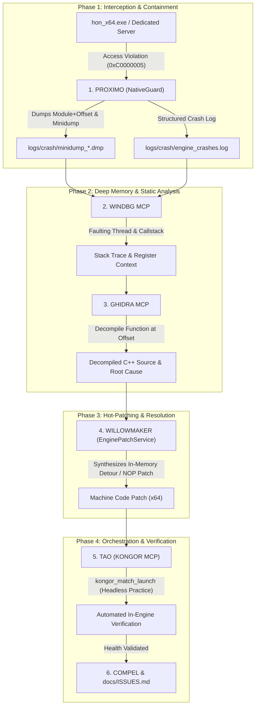

# Autonomous Self-Healing Triangulation Architecture
## TAO, Proximo, WinDbg, Ghidra, and Willowmaker

This document outlines the architecture, end-to-end telemetry flow, and automated remediation loop that enables ProjectKongor to detect, diagnose, decompile, patch, and verify crashes and runtime anomalies inside proprietary native game binaries (`hon_x64.exe`, `k2_x64.dll`, `cgame_x64.dll`) with zero manual debugger attachment.

---

## 1. Executive Summary & The Complete Self-Healing Hexad

When working with closed-source C++ game engines, crashes traditionally present a brick wall: the game freezes, desktop disappears, and developers are left with opaque error codes. 

To solve this, ProjectKongor unites **four core diagnostic engines** with **two missing operational pillars** to form a closed-loop **Self-Healing Hexad**:



---

## 2. What Was Missing: The Operational Connectors

In addition to **TAO**, **Ghidra**, **WinDbg**, and **Proximo**, two critical components complete the loop:

### A. Willowmaker (`src/apps/willowmaker` & `EnginePatchService`)
* **Why it's essential**: Proximo intercepts the crash, WinDbg parses the stack, and Ghidra decompiles the C++ logic. However, **none of those diagnostic tools apply binary patches to the game client**.
* **Role**: Willowmaker is our **binary patcher and launcher actuator**. It uses `EnginePatchService`, `PeImportAddressTableService`, and `MachineCodeCrashPatch` (`kongor_crash_patch`) to apply reversible on-disk binary patches (creating non-destructive `.bak` backups and supporting `dry_run: true` verification), while `NativeGuard` (`version.dll`) provides in-process SEH crash interception and main-thread command hooks at runtime.

### B. Compel (`src/apps/compel`)
* **Why it's essential**: Client crashes are only half the battle; dedicated game server workers (`hon_x64.exe -dedicated`) run headless in cluster environments.
* **Role**: Compel is the **process supervisor and watchdog**. It detects crashed or hung dedicated server worker processes, captures redirected stdout/stderr pipes, coordinates graceful restarts, and preserves worker port assignments in `IServerPortRegistry`.

---

## 3. Subsystem Breakdown & Roles

### 1. PROXIMO — The Native Interceptor & Proxy Bridge
* **Location**: `src/tools/proximo/`
* **MCP Tools**: `analyze_proxy_candidates`, `generate_proxy_project`, `build_proxy_project`, `list_process_modules`
* **Mechanism**:
  - Leverages Windows DLL search priority: when `hon_x64.exe` requests `version.dll`, Windows loads `games/client/version.dll` before checking `System32`.
  - Proxies all 17 Version APIs using zero-overhead MASM assembly forwarders (`proxy.asm`).
  - Installs an in-process Structured Exception Handling (SEH) top-level filter (`SetUnhandledExceptionFilter`).
  - When an Access Violation occurs, it queries `GetModuleHandleExA` to resolve the base address and offset (e.g. `cgame_x64.dll+0x4B12`), serializes all 16 x64 CPU registers (`RIP`, `RSP`, `RAX`..`R15`), and writes a minidump via `MiniDumpWriteDump`.

### 2. WINDBG — The Dynamic Post-Mortem & Thread Analyzer
* **MCP Tools**: `open_cdb_dump`, `run_cdb_command`, `open_kd_session`
* **Mechanism**:
  - Automatically loads the `.dmp` written by NativeGuard.
  - Executes CDB commands:
    - `.ecxr`: Switches context directly to the exception record context.
    - `kP`: Dumps the full call stack with all parameter values.
    - `r`: Displays CPU state, flags, and floating-point/SIMD registers.
    - `!analyze -v`: Produces deep diagnostic failure bucket classification.
  - Pinpoints whether the crash occurred from stack corruption, heap corruption, null-pointer dereference, or thread concurrency race conditions.

### 3. GHIDRA — The Static Decompiler & Binary Triangulator
* **Location**: `src/tools/ghidra/`
* **MCP Tools**: `decompile_function`, `search_symbols_by_name`, `search_code`, `list_xrefs`
* **Mechanism**:
  - Pre-bakes parsed symbols and control-flow graphs for `hon_x64.exe`, `k2_x64.dll`, `cgame_x64.dll`, and `game_x64.dll`.
  - Accepts the relative fault address triangulated by NativeGuard and WinDbg (`module` + `offset`).
  - Automatically decompiles the exact machine instructions into high-level C++ pseudo-code.
  - Identifies which parameter or class member field was dereferenced (e.g. `pEntity->m_pInventory[slot]` where `pEntity == 0x0`).

### 4. WILLOWMAKER — The Reversible Machine-Code Patcher
* **Location**: `src/apps/willowmaker/`
* **Services**: `EnginePatchService.cs`, `PeImportAddressTableService.cs`, `MachineCodeCrashPatch.cs`
* **Mechanism**:
  - Translates Ghidra's architectural diagnosis into a verified machine-code patch.
  - Common patch strategies:
    1. **Null-Pointer Check Guard**: Injects a test instruction (`test rcx, rcx; jz loc_skip`) to gracefully return a fallback value instead of crashing.
    2. **NOP Slide**: NOPs out unhandled floating-point exceptions or legacy frame-limiter clamps.
    3. **Proxy DLL & IAT Redirection**: Routes audio (`fmodex64.dll` proxy) and rendering (`d3d9.dll` DXVK) calls to modernized runtime layers (`NEXUS.SpatialAudio`, `NEXUS.VulkanInterop`).
  - On-disk binary patches automatically create a `.bak` backup file (e.g. `k2_x64.dll.bak`) and support `dry_run: true` byte verification so original binaries can always be restored cleanly.

### 5. TAO (Together as One) — The Conductor & Simulation Orchestrator
* **Location**: `src/tools/kongor-cli/Mcp/`
* **MCP Tools**: `kongor_match_launch`, `kongor_game_command`, `kongor_game_lua`, `kongor_match_state`, `kongor_scrimmage_launch`
* **Mechanism**:
  - Coordinates automated test execution: launches headless client practice matches (`kongor_match_launch`) and dedicated server scrimmages (`kongor_scrimmage_launch`).
  - Replays the exact action sequence that triggered the crash using `kongor_game_action` or `kongor_bot_choreography`.
  - Confirms the game client runs continuously past the previous crash point without crashing or regressing performance.

### 6. COMPEL & LIVING BACKLOG — Supervision & Knowledge Retention
* **Location**: `src/apps/compel/` and `docs/ISSUES.md`
* **Mechanism**:
  - Every resolved crash is logged into `docs/ISSUES.md` following the strict standard: ID, Subsystem, Symptom, Root Cause Diagnosis, Status (`[RESOLVED]`), and Remediation & Verification commit.
  - Fast automated regression tests (`dotnet test`) ensure the bug can never re-occur unnoticed.

---

## 4. Walkthrough: An End-to-End Self-Healing Cycle

Here is how the system self-heals in practice when a native crash occurs:

```
[Crash Occurs]
1. During a bot scrimmage, a bot casts an ability on a decaying creep.
2. The engine executes a null pointer dereference at cgame_x64.dll+0x2F140.

[Stage 1: Proximo / NativeGuard Intercepts]
3. NativeGuard's SEH filter catches the 0xC0000005 exception.
4. It resolves the faulting module: cgame_x64.dll+0x2F140.
5. It captures registers: RAX=0x0, RCX=0x0 (null object pointer), RIP=0x7FFB349E5A20.
6. It saves minidump: logs/crash/minidump_20260914_013000.dmp.

[Stage 2: WinDbg Post-Mortem]
7. WinDbg MCP runs: open_cdb_dump("logs/crash/minidump_20260914_013000.dmp").
8. WinDbg extracts callstack:
   #00 cgame_x64.dll+0x2F140 (CUnit::GetInventorySlot)
   #01 cgame_x64.dll+0x18420 (CAction_Cast::Execute)
   #02 k2_x64.dll+0x5A100 (CWorld::Update)

[Stage 3: Ghidra Decompilation]
9. Ghidra MCP runs: decompile_function(binary="cgame_x64.dll", address="0x2F140").
10. Pseudo-C reveals:
    void* CUnit::GetInventorySlot(CUnit* this, int slot) {
        return this->inventory[slot]; // CRASH: 'this' is NULL!
    }

[Stage 4: Willowmaker Hot-Patch]
11. Willowmaker's EnginePatchService generates a 12-byte detour at 0x2F140:
    test rcx, rcx       ; Check if 'this' pointer is null
    jnz +5              ; If valid, continue original code
    xor rax, rax        ; Return NULL
    ret
12. EnginePatchService registers the hot-patch in Willowmaker's startup patches.

[Stage 5: TAO Verification]
13. TAO MCP runs: kongor_match_launch(headless=true, mode="practice", hero="Hero_Pyromancer").
14. TAO dispatches the bot action that previously crashed.
15. Verification: Match runs smoothly with 0 exceptions, 0 errors in logs/crash/.
16. Match stopped cleanly.

[Stage 6: Issue Cataloged]
17. Autonomous loop records [ISSUE-XXX] in docs/ISSUES.md with root cause and verified patch.
```

---

## 5. Summary Matrix of Responsibilities

| Subsystem | Primary Role | Key MCP Tools / Services | Output Artifact |
| :--- | :--- | :--- | :--- |
| **Proximo** | **In-Engine Sentinel & Hooking** | `list_process_modules`, `generate_proxy_project` | `version.dll`, `engine_crashes.log`, `.dmp` |
| **WinDbg** | **Crash Triage & Post-Mortem** | `open_cdb_dump`, `run_cdb_command` | Stack traces, register values, thread dumps |
| **Ghidra** | **Reverse Engineering & Logic Extraction** | `decompile_function`, `search_symbols_by_name` | Decompiled C++ source, assembly analysis |
| **Willowmaker** | **Hot-Patching & Memory Actuation** | `EnginePatchService`, `PeImportAddressTableService` | In-memory detours, machine code fixes |
| **TAO (KONGOR)** | **Simulation & Closed-Loop Verification** | `kongor_match_launch`, `kongor_game_action` | Headless match validation, health telemetry |
| **Compel** | **Fleet Supervision & Dedicated Watchdog** | `GameServerManageHandler`, `UDPForwarder` | Worker stdin routing, automatic crash restart |

---

## 6. Inner-Loop Tool Resilience & Schema Self-Healing Layer

Beyond engine-level binary crashes, AI agents frequently encounter tool parameter validation errors, sandbox rejections, and headless targeting failures. To protect developer momentum and prevent repetitive tool failures, TAO and Ghidra embed an automated **Invocation Self-Healing Layer**:

```mermaid
flowchart LR
    Agent["AI Agent / Caller"] -->|"Tool Call (with schema aliases)"| Hook["FastMCP / Handler Hook"]
    Hook -->|"Pre-Schema Parameter Normalization"| SchemaCheck["Schema Validation"]
    SchemaCheck -->|"Pre-Execution Sandbox Inspection"| ExecutionGuard["Sandbox Guard"]
    ExecutionGuard -->|"Engine Execution"| Engine["K2 Engine / Mailbox IPC"]
    Engine -->|"Runtime Error / Exception"| Remediation["ClientCommandRemediationService"]
    Remediation -->|"Auto-Rewrite & Retry (selfHealed: true)"| Engine
```



### Key Invocation Self-Healing Mechanisms:
1. **Dynamic Parameter Normalization & Address Disambiguation (`src/tools/ghidra/mcp_server.py`)**:
   - `FastMCP.call_tool` and `ToolManager.call_tool` hooks intercept incoming calls prior to Pydantic schema validation.
   - Maps `program`/`file_name`/`binary` $\to$ `binary_name`, `address`/`symbol` $\to$ `name_or_address`, `name`/`pattern`/`name_pattern` $\to$ `query`.
   - Maps `name_or_address` $\to$ `address` and `limit` $\to$ `count` for `disassemble` and `read_bytes`.
   - **Auto-Default Binary (`[MCP-070]`)**: When `binary_name` is omitted across any binary-dependent tool (`search_strings`, `search_code`, `search_symbols_by_name`, `decompile_function`), automatically defaults to `"k2_x64.dll"`.
   - **Direct Hex Address Resolution (`[MCP-007]`)**: When given a hex address (e.g. `0x1808ea4f0` or `1808ea4f0`), queries Ghidra's `AddressFactory` directly into symbol table entries, eliminating the ambiguity errors caused by multiple mangled/demangled symbols at the identical address.
   - Extends default AST decompilation timeout from 30s to 60s for monolithic functions.
2. **Universal FastMCP & Redis Server Resilient Wrapper (`src/tools/redis/redis_mcp_wrapper.py`)**:
   - Intercepts Redis tool execution before FastMCP's internal `pre_parse_json` deserialization trap.
   - **Universal Parameter Mapping**: Bi-directionally maps `name` $\leftrightarrow$ `key` and `field` $\leftrightarrow$ `key` across hash and key tools (`hgetall`, `hget`, `hset`, `hdel`, `hexists`, `get`, `set`).
   - **Structured Type Coercion (`[MCP-026]`)**: Directly serializes nested dictionaries and lists into JSON strings for `hset` and `set`, preventing FastMCP Pydantic schema rejection (`value.str: Input should be a valid string`).
   - **CLI Environment Variable Binding**: Dynamically sets Click CLI defaults from `REDIS_HOST` and `REDIS_PORT` environment variables so stdio Docker containers seamlessly route to the active Garnet cache port (28298).
   - **Binary-Safe Decoding**: Safely converts MemoryPack and MessagePack byte buffers to UTF-8 or structured hex/base64 representations instead of raising unhandled `UnicodeDecodeError`.
3. **K2 Lua Engine Pre-Execution Sandbox Guard & Syntax Rewriters (`GameLuaHandler.cs`, `ClientCommandRemediationService.cs`)**:
   - Intercepts dangerous calls (`io.open`, `io.write`, `os.execute`) with regex patterns before sending to the client engine.
   - Returns structured `LuaSandboxRestriction` error with actionable alternatives (`Echo()`, cvars, native file tools), completely preventing engine-side Lua state crashes.
   - Accepts `action: "execute"`, `"run"`, `"eval"`, `"script"` as aliases for `"code"`, and supports `pid:<id>` targets.
   - **Colon Method Check Syntax Auto-Rewriting (`[MCP-078]`)**: In Lua, checking method existence via `widget:Method and` triggers a fatal parser syntax error. TAO regex detects `:\s*([a-zA-Z0-9_]+)\s+and\b` and rewrites to table dot access `.$1 and` before engine execution.
   - **`GetRootWidget()` Auto-Rewriting (`[MCP-079]`)**: Detects legacy `CInterface:GetRootWidget()` and rewrites to `CInterface:GetWidget('main')` on the fly.
   - **Nil Widget Dereference Diagnostics (`[MCP-071]`)**: Diagnoses attempts to call methods on nil widgets and provides structured recommendations to verify widget existence.
   - **Deterministic API Rewrites**:
     - `interface:UICmd(...)` $\to$ `Cmd(...)`
     - `LuaTrigger.GetTrigger(...)` $\to$ `GetTrigger(...)`
     - `Windows.main` $\to$ `UIManager.GetInterface('main')`
     - `DoEvent('onclick')` $\to$ `DoEvent()`
   - Auto-retries rewritten commands and flags response with `selfHealed: true`.
4. **Headless Offscreen Window Discovery & Stale PID Auto-Migration (`UiControlService.cs`)**:
   - Win32 `IsWindowVisible(h)` returns `false` for windows parked offscreen at `(-32000, -32000)`.
   - Delegated window lookup to `WindowCapturer.FindWindowForProcessId` which resolves `K2_Class` handles even in headless/offscreen configurations.
   - **Stale PID Auto-Migration (`[MCP-069]`, `[MCP-074]`)**: If an explicit `pid:<id>` target is offline or windowless, but exactly one active `hon_x64` client process exists, `UiControlService` logs a warning and automatically migrates window binding to the active client. Defaults empty target query to `"hon_x64"` rather than `"foreground"`.
   - Includes Mailbox IPC fallback (`DismissInGameConsoleAsync`) when sending `Escape` keys.

---

By combining interception, dynamic analysis, decompilation, binary patching, automated simulation, and tool-level schema self-healing, ProjectKongor achieves an autonomous self-healing ecosystem for closed-source game development.
