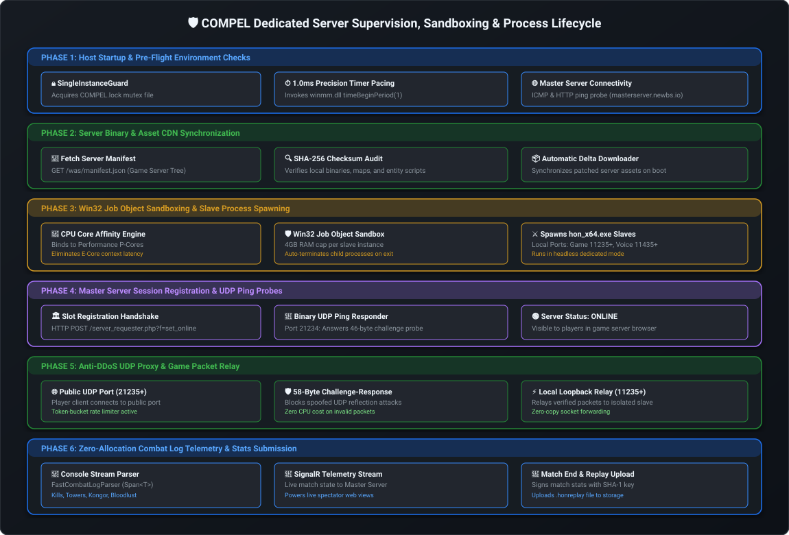

<div align="center">

# 🛡️ COMPEL
### *Dedicated Game Server Fleet Manager & Process Supervisor*

[](https://dotnet.microsoft.com/)
[](#)
[](#)
[](#)

**COMPEL is the dedicated game server manager for ProjectKongor. It orchestrates `hon_x64` match slave instances in isolated sandboxes, enforces sub-millisecond timer pacing, and manages heartbeats with the Master Server.**

[⚡ Quickstart](#-quickstart) •
[🌟 Key Features](#-key-features) •
[🗺️ Server Lifecycle Diagram](#-server-lifecycle--sandbox-architecture) •
[⚙️ Configuration](#️-configuration-appsettingsjson)

---

### ⚡ Quickstart: Host Dedicated Servers
Launch the COMPEL supervisor and manage match instances in **Windows PowerShell**:

```powershell
kongor host
```
*(Or via .NET CLI: `dotnet run --project src/apps/compel/COMPEL.csproj`)*

---

</div>

## 🌟 Key Features

* **📦 Win32 Job Object Isolation**: Encloses slave match processes in Job Objects to guarantee automatic cleanup of orphan processes on termination.
* **⏱️ 1.0ms High-Precision Timer Pacer**: Enforces sub-millisecond multimedia timer resolution to ensure consistent 50Hz/100Hz server tickrates.
* **🛡️ UDP Proxy & Anti-DDoS**: Challenge-response handshake proxy for UDP ports (`21235+`), mitigating amplification and spoofing attacks.
* **💓 Master Server Registration**: Automates periodic heartbeats, player slot reporting, and match state transitions to the KONGOR Master Server.
* **📊 Remote REST Control**: Built-in HTTP API (`/ping`, `/status`, `/start`, `/stop`) for remote fleet supervision.
* **🌸 TAO (Together As One) Fleet Supervision**: Managed directly via the [TAO MCP Server](../../../docs/tao-mcp/overview.md) (`kongor_game_server_manage`, `kongor_server_perf_stream`, `kongor_game_server_command`) for sub-second telemetry and authoritative command routing.

---

## 🗺️ Server Lifecycle & Sandbox Architecture

<div align="center">
  
</div>

---

## 🖥️ Dedicated Server Directory Setup (HoN 4.10.1)

COMPEL supervises child `hon_x64.exe` dedicated server slave processes:

### 📂 Method 1: Default `games/server/` Directory (Recommended)
1. Copy your clean HoN 4.10.1 dedicated server files into `games/server/` at the repository root.
2. COMPEL automatically detects `games/server/hon_x64.exe` as the default target binary.

### 🔗 Method 2: Custom Installation Directory
Configure an alternate server installation directory in `appsettings.json` under `"ServerFleet:InstallationPath"` or via the Control Panel GUI Settings vault (`GameServerPath`).

---

## ⚙️ Configuration (`appsettings.json`)

```json
{
  "ServerFleet": {
    "MasterServerUrl": "http://127.0.0.1:55555",
    "BasePort": 21235,
    "MaxInstances": 4,
    "ServerName": "ProjectKongor Dedicated Node",
    "Location": "USE",
    "TimerResolutionMs": 1.0
  }
}
```

---

> [!CAUTION]
> ### ⚠️ Network & Firewall Notice
> Dedicated server nodes require open inbound UDP ports (`21235` through `21245`) and TCP port `8080` in your router or hosting provider firewall. Read the full [VPS Gateway Hosting Guide](../../../docs/infrastructure/vps-hosting-guide.md) for automated port-forwarding scripts.
