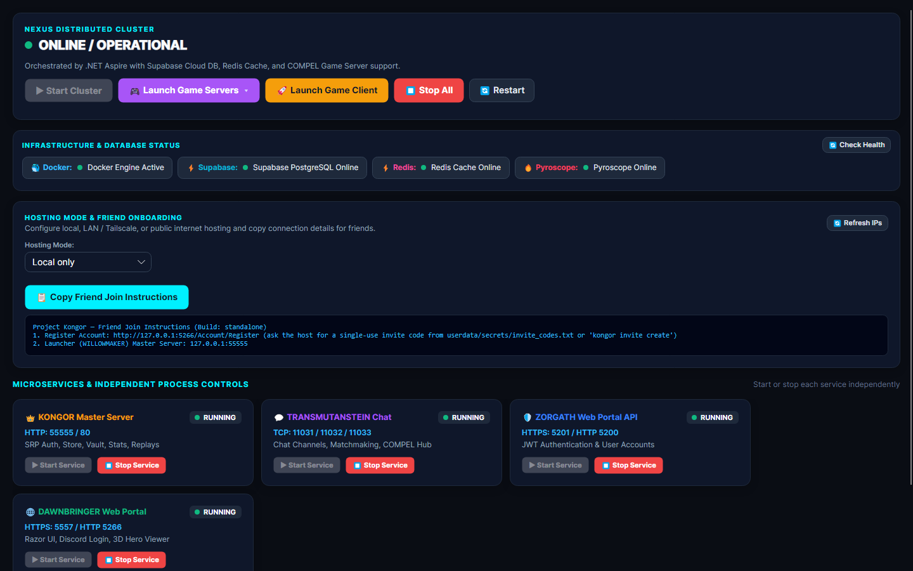
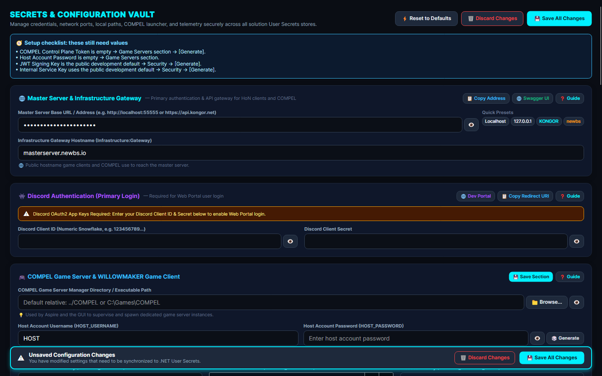
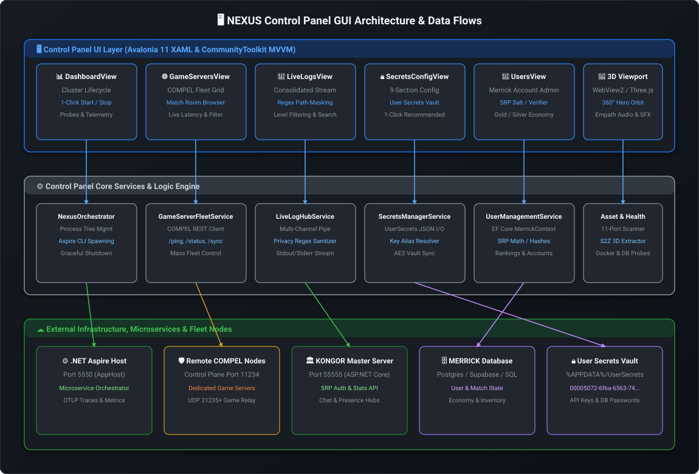

<div align="center">

# 🖥️ NEXUS Control Panel
### *Cross-Platform Administration Desktop GUI & Server Browser*

[](https://dotnet.microsoft.com/)
[](https://avaloniaui.net/)
[](#)
[](#)

**NEXUS Control Panel is the flagship cross-platform desktop administration dashboard for ProjectKongor. Built with Avalonia 11 and ReactiveUI, it provides unified management of player accounts, dedicated server nodes, 3D heroes, and developer secrets.**

[⚡ Quickstart](#-quickstart) •
[📸 Screenshots](#-visual-showcase) •
[🌟 Key Features](#-key-features) •
[🗺️ Architecture Map](#-control-panel-architecture)

---

### ⚡ Quickstart: Launch Control Panel
Launch the desktop administration GUI in **Windows PowerShell**:

```powershell
kongor gui
```
*(Or via .NET CLI: `dotnet run --project src/apps/control-panel/NEXUS.ControlPanel.GUI.csproj`)*

---

</div>

## 📸 Visual Showcase

<div align="center">

| 📊 Cluster Orchestration Dashboard | 🔑 Secrets & Configuration Vault |
| :---: | :---: |
|  |  |
| *Supervise Master Server, Chat Server, Web Portal, and Docker/Supabase health* | *Manage masked developer credentials, ports, and COMPEL configuration safely* |

</div>

---

## 🌟 Key Features

* **🐳 Turnkey Docker Stack Controls (`kongor-stack`)**: Built-in **`🐳 Docker Stack ▾`** toolbar flyout (`Launch Eco`, `Launch Balanced`, `Launch Max`, `Stop Docker Stack`, `Rotate Placeholder Secrets`), `[kongor-stack: 7/7 running]` health badge, Docker-aware `Restart` / `Stop` / `Stop All` routing, and live log streaming from `logs/docker/<service>/`.
* **👤 Account & Role Management**: View, edit, ban, and modify player accounts, MMR, PSR, Goblin store coins, and permissions.
* **🌐 Live Server Browser**: Real-time list of all active dedicated server nodes (Host `:11234`, Docker Tier D `:11334`, Queue Arcade Tier Q `:11484`), running matches, connected players, and ping latencies.
* **🗿 Interactive 3D Hero Viewport**: High-fidelity Three.js / WebView2 hero viewer that renders glTF/GLB models, textures, animations, and particle effects.
* **🔐 User Secrets Vault Editor & Safe Rotation**: Native GUI editor for managing canonical developer secrets (`00005072-6f6a-6563-7420-4b4f4e474f52`) with `.bak`-backed placeholder secret rotation synchronized across service alias keys.
* **📜 Live Log Streaming**: Real-time colorized logs from Master Server, Chat Server, Web Portal, and COMPEL instances across both native host and Docker deployments.

---

## 🗺️ Control Panel Architecture

<div align="center">
  
</div>

---

## 🎮 Game Client & Server Detection (HoN 4.10.1)

The Control Panel includes the built-in `NexusOrchestratorService` which automatically locates and supervises local game instances:

1. **Auto-Detection (Canonical Directory)**:
   * **Client**: Checks `games/client/WILLOWMAKER.exe` or `games/client/hon_x64.exe`.
   * **Server**: Checks `games/server/COMPEL.exe` or `games/server/hon_x64.exe`.
   * If you paste a clean HoN 4.10.1 installation into `games/client/` or `games/server/`, the Control Panel discovers it automatically.

2. **Custom Paths (Settings / Secrets Vault)**:
   * If HoN 4.10.1 is installed elsewhere on your drive, open **Settings / Vault** in the GUI and configure:
     * `GameClientPath`: e.g. `C:\Games\Heroes of Newerth 4.10.1`
     * `GameServerPath`: e.g. `C:\Games\HoN Server 4.10.1`

---

## 🐳 Turnkey Docker Stack Management (`kongor-stack`)

The Dashboard command bar includes a **`🐳 Docker Stack ▾`** flyout menu alongside local .NET Aspire controls so operators can launch, monitor, and inspect the complete 7-container Docker Compose stack ([`infra/docker/docker-compose.stack.yml`](../../../infra/docker/docker-compose.stack.yml)) without leaving the GUI:

* **One-Click Preset Launchers**: Start the stack in **`Launch Eco`**, **`Launch Balanced`**, or **`Launch Max`** (`High`) mode, or tear it down cleanly via **`Stop Docker Stack`**.
* **Live Container Status & Log Tailing**: Displays a real-time `[kongor-stack: 7/7 running]` health pill, maps container health directly onto the Dashboard service cards (`master-server`, `chat-server`, `web-api`, `web-ui`, `compel-dedicated`, `compel-queue-arcade`, `garnet`), and streams live container logs from `logs/docker/<service>/`.
* **Docker-Aware Lifecycle Guards**: Automatically routes per-service **`Restart`**, **`Stop`**, and **`Stop All`** actions safely through Docker Compose when `kongor-stack` is active instead of terminating host processes blindly.
* **Safe Secret Rotation**: Click **`Rotate Placeholder Secrets`** (or **Generate Defaults** in **Secrets & Config**) to back up `secrets.json` (`.bak`) and synchronize cryptographic JWT, COMPEL, and internal service keys across alias keys (`kongor docker init-secrets` parity).

---

## 🕹️ Hosting Queue Arcade ("While You Wait" Mini-Games)

The Dashboard includes a dedicated **`🕹️ Queue Arcade ▾`** action menu next to **`🎮 Launch Game Servers ▾`** so self-hosters and contributors can run drop-in/drop-out matchmaking mini-games alongside Ranked dedicated servers with zero port or account collisions:

* **Zero Manual Account Setup**: Queue Arcade automatically derives an isolated `<host>_arc` `ServerHost` account (`<= 15` chars for HoN/PostgreSQL `VARCHAR(15)` compatibility, e.g. `kongor_host` -> `kongor_host_arc`, `<myhost>` -> `<myhost>_arc`) from your primary `HostAccountUserName` and auto-provisions/syncs its SRP verifier on startup and on first `f=replay_auth` / `f=new_session` handshake.
* **Side-by-Side Port Partition (`PortRangeOffset = 250`, Tier `Q`)**:
  * **Control Plane & Ping**: `127.0.0.1:11484` (auto-discovered in the **Game Servers** tab)
  * **Local Game UDP**: `11485..11534` (`#Q1` kept warm for instant join; `#Q2` stays idle until `#Q1` reaches `>= 80%` human occupancy)
  * **Docker Container**: `compel-queue-arcade-server` (isolated from Ranked `compel-dedicated-server`)
* **Live Pause / Resume & Graceful Fallback**:
  * Toggle **`✅ Queue Arcade: Enabled`** / **`⏸️ Queue Arcade: Paused`** directly from the menu (synced live via Redis key `kongor:queue_arcade:enabled` and persisted in `QueueArcade:Enabled`).
  * If no Queue Arcade servers are running or Queue Arcade is paused, normal matchmaking operates identically to standard queuing; players can click **`[LEAVE MINI-GAME]`** at any time without losing their matchmaking queue spot.
* **Strict Region Matching**: Queue Arcade inherits the **`Location / Region Code`** (`Compel:Location`, e.g. `USE`, `USW`, `EU`, `AU`, `BR`, `LAT`, `RU`) configured in **Secrets & Config**, and strictly only pulls queued players who selected a matching region.
* **CLI Equivalent**: Run [`scripts/docker/launch_queue_minigame_server.ps1`](../../../scripts/docker/launch_queue_minigame_server.ps1).

---

> [!TIP]
> ### 💡 Canonical Secrets Vault Initialization
> You can initialize the canonical developer User Secrets before launching for the first time:
> ```powershell
> dotnet user-secrets init --project src/apps/control-panel/NEXUS.ControlPanel.GUI.csproj --id 00005072-6f6a-6563-7420-4b4f4e474f52
> ```
