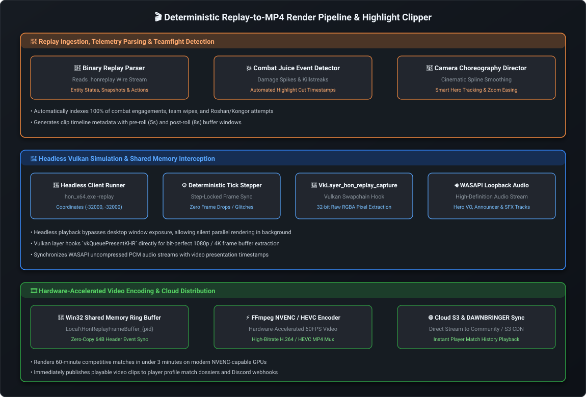
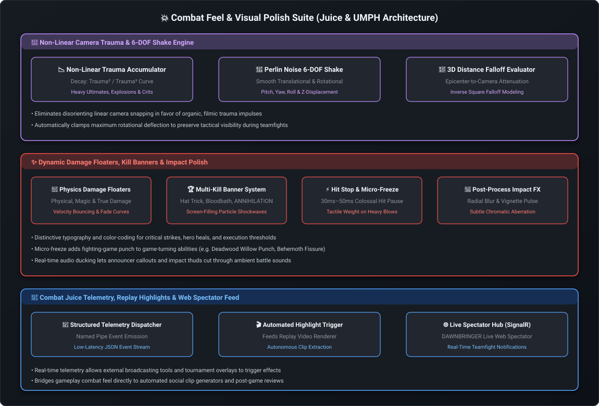

# 🎬 NEXUS Replay Studio (`ReplayStudio.GUI`)

> **Experimental desktop replay director, camera spline editor, and 60 FPS MP4 highlight studio (`net11.0`, Avalonia 11.2.3).**

`ReplayStudio.GUI` is a cross-platform Avalonia workstation tool for loading `.honreplay` match recordings, scrubbing combat timelines, authoring `CatmullRomSpline` camera director paths, previewing viewport frames, and exporting MP4 clips via `ReplayRenderer.Service`.

---

## ⚡ Quick Start

```powershell
# Launch Replay Studio GUI
dotnet run --project src/apps/replay-studio/ReplayStudio.GUI.csproj

# Launch with CLI options
dotnet run --project src/apps/replay-studio/ReplayStudio.GUI.csproj -- --replay <path/to/match.honreplay> --timestamp 420 --camera free
```

### Supported CLI Options
- `--replay <path>` — Path to `.honreplay` recording
- `--timestamp <sec>` — Initial seek offset in seconds
- `--camera <mode>` — Initial camera mode (`PlayerPov`, `free` / `FreeSpectator`, `rts` / `RtsIsometric`, `firstperson` / `1st`)

---

## 🏗️ Architecture

- **Director & Camera (`Director/`):** `CameraDirector`, `CatmullRomSpline`, and `LightingController`
- **Playback Engine (`Engine/`):** `ReplaySnapshotEngine`, `PlaybackClock`, and `MapEnvironmentManager`
- **Export Pipeline (`Export/`):** `VideoExportPipeline`, `AudioStreamSyncBuffer`, and `ExportPreset` backed by `src/extensions/replay-renderer/`
- **UI Modules (`Controls/`, `Views/`, `ViewModels/`):** `VulkanViewportControl`, `TimelineScrubberControl`, `RosterPanelView`, and `ExportModalView`

### Replay & Combat Telemetry Pipelines

<div align="center">
  
</div>

<div align="center">
  
</div>

---

## 📖 Related Documentation

- [Replay Video Renderer (`NEXUS.ReplayRenderer`)](../../extensions/replay-renderer/README.md)
- [Replay Studio Architecture Notes](../../../docs/architecture/replay-studio-future-work.md)
