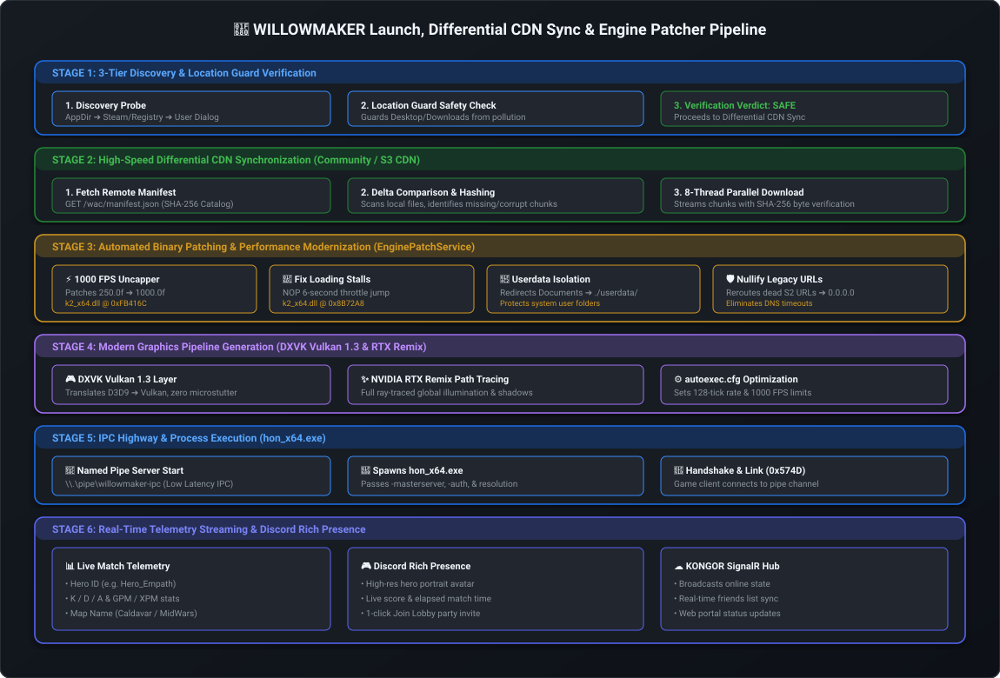
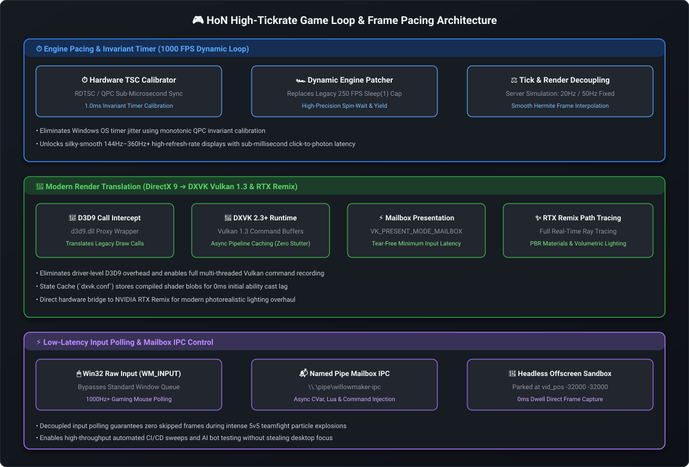
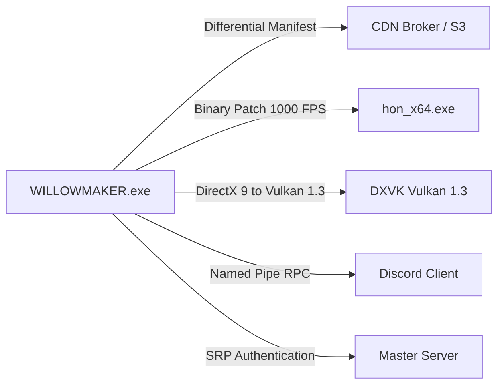

<div align="center">

# 🚀 WILLOWMAKER
### *High-Performance Game Client Launcher & Modernization Runtime*

[](https://dotnet.microsoft.com/)
[](https://www.vulkan.org/)
[](#)
[](#)

**WILLOWMAKER is the desktop game launcher and client modernization runtime for Heroes of Newerth (K2 Engine).**

[⚡ Quickstart](#-quickstart) •
[🌟 Key Features](#-key-features) •
[🗺️ Architecture Pipeline](#-engine-modernization--game-loop-pipeline) •
[🎮 Game Files Setup](#-game-client-directory-setup-hon-4101)

---

### ⚡ Quickstart: Launch Heroes of Newerth
Launch WILLOWMAKER with 1000 FPS, DXVK Vulkan 1.3, and CDN delta patching in **Windows PowerShell**:

```powershell
kongor play
```
*(Or via .NET CLI: `dotnet run --project src/apps/willowmaker/WILLOWMAKER.csproj`)*

---

</div>

## 🌟 Key Features & Technical Specifications

* **🏎️ 1000 FPS Dynamic Engine Patcher (`EnginePatchService`)**: Patches `k2_x64.dll` main loop tick timer and frame limiter from 250 FPS up to 1000 FPS (creating a non-destructive `k2_x64.dll.bak` backup) to support high-refresh-rate displays.
* **🌋 DXVK Vulkan 1.3 & Startup Tuning (`RenderModernizationService`)**: Translates legacy DirectX 9 draw calls to Vulkan 1.3 via DXVK and configures `userdata/HONGarena/startup.cfg` (`host_maxfps`, `vid_vsync`, `vid_vulkan`) for consistent frame pacing.
* **🛡️ Clean Override Workspace Preservation**: Leaves `games/client/override/` untouched by default (`WILLOWMAKER_SYNC_PACKAGE_FILES=0`) so only active developer hot-reload diffs reside in `override/`, while base client interfaces load directly from `ClientPackageFiles.s2z`.
* **📦 Differential CDN Delta Patching**: Connects to configurable community/S3 CDN endpoints to inspect manifests and download missing or modified assets with SHA-256 and CRC32 verification.
* **🎮 Discord Rich Presence**: Integrates with the Discord desktop client via Named Pipes (`DiscordPresenceService`) to broadcast active game modes, hero portraits, and match time.
* **🌸 TAO (Together As One) Companion & Zero-Focus-Theft IPC**: Interconnects with the [TAO MCP Server](../../../docs/tao-mcp/overview.md) over `\\.\pipe\willowmaker-ipc` and the `CompositeGameIpcBridge` (`version.dll` NativeGuard / `tao_req` mailbox) for engine telemetry, Lua scripting, offscreen UI verification, and command remediation.
* **⚡ ReadyToRun & Dynamic PGO Compiled**: Built on .NET 11 with Release `PublishReadyToRun`, `TieredPGO`, and `<IsAotCompatible>` source-generated JSON/MemoryPack serialization.

---

## 🗺️ Engine Modernization & Game Loop Pipeline

<div align="center">
  
</div>

<div align="center">
  
</div>

<details>
<summary>🔍 View Mermaid Source</summary>


</details>

---

## 🎮 Game Client Directory Setup (HoN 4.10.1)

WILLOWMAKER modernizes and launches Heroes of Newerth v4.10.1 (`hon_x64.exe`):

### 📂 Method 1: Local `games/client/` Directory (Bring-Your-Own-Assets)
1. Place or symlink your lawfully acquired *Heroes of Newerth (`v4.10.1`)* installation under `games/client/` (or run `.\scripts\vfs\Hydrate-LocalGameAssets.ps1`) so `games/client/` contains `hon_x64.exe`, `base/`, and `game/`.
2. Run `kongor play` in Windows PowerShell. WILLOWMAKER discovers the binary, applies `EnginePatchService` + `RenderModernizationService`, and launches automatically.

### 🔗 Method 2: Custom Client Path
If your HoN installation is located elsewhere on your drive:
* Open the **NEXUS Control Panel GUI** (`kongor gui`), navigate to **Settings / Vault**, and set `GameClientPath` to your directory (e.g. `C:\Games\Heroes of Newerth 4.10.1`).

---

> [!TIP]
> ### 💡 Performance Recommendation
> For maximum competitive responsiveness, set your monitor refresh rate to maximum (144Hz – 360Hz) and allow WILLOWMAKER's 1000 FPS pacer to handle frame synchronization.

> [!IMPORTANT]
> ### ⚖️ Preservation & Clean-Room Notice
> WILLOWMAKER's source code is cleanroom open-source C# (`AGPL-3.0-or-later`, honoring upstream `[K]ONGOR` lineage). Public source checkouts distribute **zero** retail `.s2z` archives or game executables (`0` Git LFS dependencies); local game binaries must be supplied by the user.
