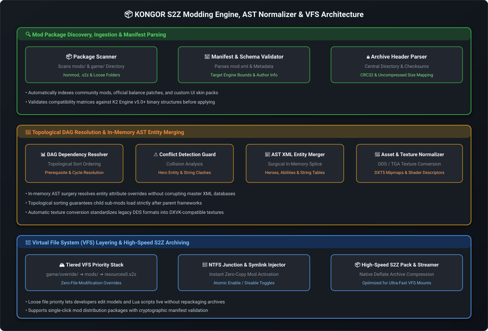

<div align="center">

# 📦 HoN S2Z Modding Engine & VFS (`NEXUS.Modding`)
### *Archive Packaging, XML Entity Merging & Virtual File System Layer*

[](https://dotnet.microsoft.com/)
[](#)
[](#)

**HoN Modding Engine provides archive manipulation, XML entity merging, DAG dependency resolution, and Virtual File System (VFS) layering tools for Heroes of Newerth modding.**

[⚡ Quickstart](#-quickstart-mod-management) •
[🌟 Key Features](#-key-features) •
[🗺️ Mod Pipeline Map](#-mod-pipeline-architecture)

---

### ⚡ Quickstart: Mod Management
Manage and apply community mods in **Windows PowerShell**:

```powershell
# List available mods
kongor mod list

# Enable and apply mods with DAG ordering
kongor mod enable <mod_name>
kongor mod apply
```

---

</div>

## 🌟 Key Features

* **📦 S2Z Archive Packer/Unpacker**: Native manipulation of `.s2z` ZIP archives with uncompressed headers and deflate payload compression.
* **📜 XML Entity Modernizer**: In-memory patching and merging of hero XML definitions, ability scripts, and UI string tables.
* **📂 Loose File Priority**: Manages the `game/override/` virtual directory hierarchy for zero-conflict client overrides.

---

## 🗺️ Mod Pipeline Architecture

<div align="center">
  
</div>
