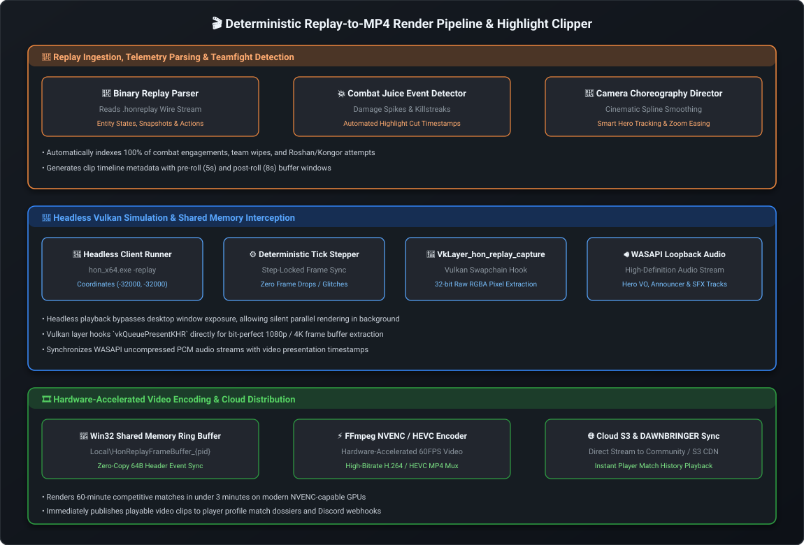
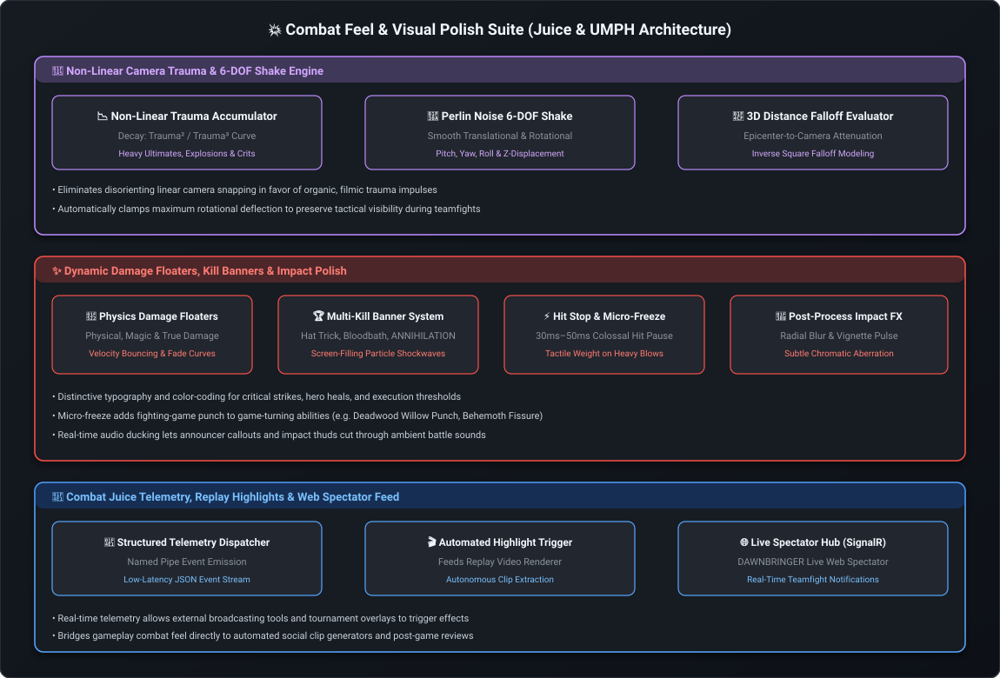

<div align="center">

# 🎬 Replay Video Renderer (`NEXUS.ReplayRenderer`)
### *Headless Vulkan to 60FPS MP4 Match Highlight Renderer*

[](https://dotnet.microsoft.com/)
[](https://ffmpeg.org/)
[](https://www.vulkan.org/)

**Replay Video Renderer is the automated highlight extraction and 60FPS MP4 video rendering engine for ProjectKongor match replays (`.honreplay`).**

[⚡ Quickstart](#-quickstart-render-highlights) •
[🌟 Key Features](#-key-features) •
[🗺️ Replay Pipeline Map](#-replay-renderer--combat-juice-architecture)

---

### ⚡ Quickstart: Render Highlights
Automatically detect teamfights and render an MP4 highlight reel in **Windows PowerShell**:

```powershell
kongor highlight <path/to/match.honreplay>
```
*(Or render the full 60FPS match: `kongor replay render <match.honreplay>`)*

---

</div>

## 🌟 Key Features

* **🎥 Automated Teamfight Detection**: Analyzes combat juice events, rapid hero kills, and high damage spikes to generate highlight clip timestamps.
* **🌋 Headless Vulkan Frame Capture**: Captures 1080p/4K 60FPS offscreen game frames via Vulkan swapchain intercept.
* **🎞️ FFmpeg & NVENC Video Encoding**: Direct hardware-accelerated H.264 / HEVC video encoding for instant replay sharing.

---

## 🗺️ Replay Renderer & Combat Juice Architecture

<div align="center">
  
</div>

<div align="center">
  
</div>
