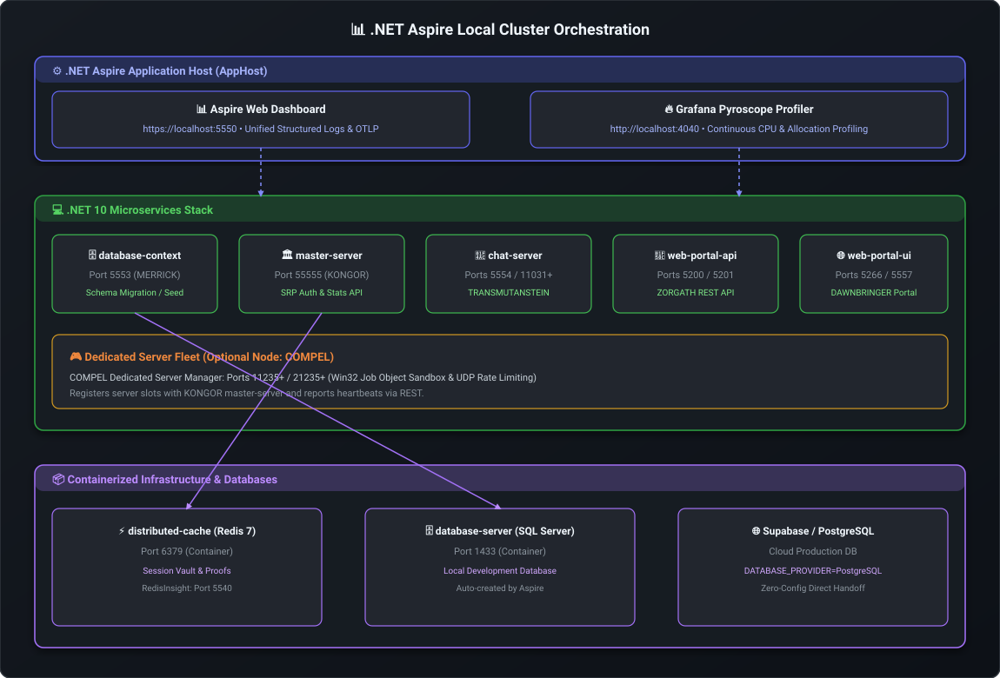

<div align="center">

# ⚙️ ASPIRE Application Host
### *Cloud-Native Distributed Microservice Orchestrator*

[](https://dotnet.microsoft.com/)
[](https://learn.microsoft.com/en-us/dotnet/aspire/)
[](https://opentelemetry.io/)
[](https://pyroscope.io/)

**ASPIRE ApplicationHost is the local orchestration layer that coordinates ProjectKongor's 4 core backend services (`MasterServer`, `ChatServer`, `WebAPI`, `WebUI`), Garnet/Redis cache, database, and optional sidecars into a unified development environment.**

[⚡ Quickstart](#-quickstart) •
[📊 Orchestrated Services](#-orchestrated-services-matrix) •
[🗺️ Architecture Topology](#-orchestration-architecture-topology)

---

### ⚡ Quickstart: Launch Cluster
Launch the local service cluster with interactive telemetry in **Windows PowerShell**:

```powershell
kongor start
```
*(Or launch standalone: `dotnet run --project src/services/aspire-host/ASPIRE.ApplicationHost.csproj`)*  
**Live Interactive Dashboard**: [`https://localhost:5550`](https://localhost:5550)

---

</div>

## 📊 Orchestrated Services Matrix

| Service | Target Port | Protocol | Technical Role |
|---|---|---|---|
| **Master Server** | `55555` | HTTP/REST | Player authentication, SRP-6a, Goblin store, stats ingestion |
| **Chat Server** | `11031-11033` | TCP Binary | Zero-copy binary chat pipelines, channels, whispers, lobbies |
| **Web API (Zorgath)** | `5100 / 5101` | HTTPS/REST | Public REST API for web portal, leaderboards, match history |
| **Web UI (Dawnbringer)** | `5200 / 5201` | HTTPS/MVC | Responsive player portal, leaderboards, account registration |
| **Replay Renderer *(Experimental)*** | `5300` | HTTP/gRPC | Optional sidecar for replay-to-MP4 highlight video rendering |
| **PostgreSQL / SQLite** | `5432` | TCP/SQL | Primary relational database (MERRICK multi-DB schema) |
| **Garnet / Redis Cache** | `6379` | TCP/RESP | Distributed caching, session tokens, and Pub/Sub backplane |
| **Pyroscope *(Optional)*** | `4040` | HTTP | Continuous CPU and memory flamegraph profiling sidecar |
| **Aspire Dashboard** | `5550` | HTTPS | Interactive web UI with OpenTelemetry traces, metrics & logs |

---

## 🗺️ Orchestration Architecture Topology

<div align="center">
  
</div>

---

> [!TIP]
> ### 💡 Live Telemetry & Distributed Traces
> Access `https://localhost:5550` while testing. You can inspect exact execution millisecond timings for any database query, Redis cache hit, or HTTP request across the entire system.
