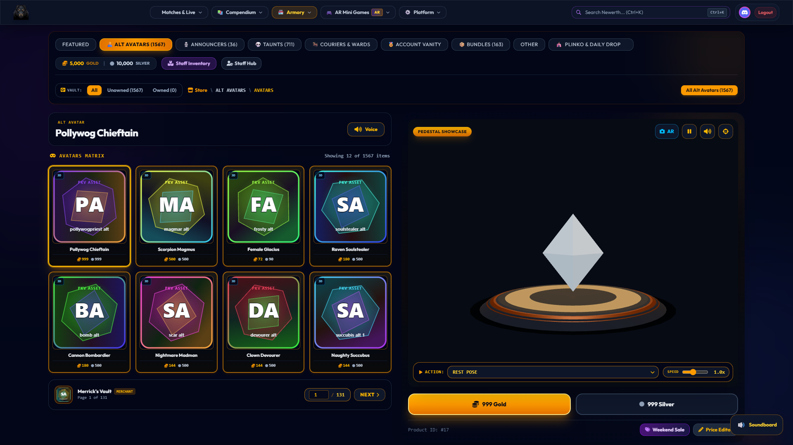
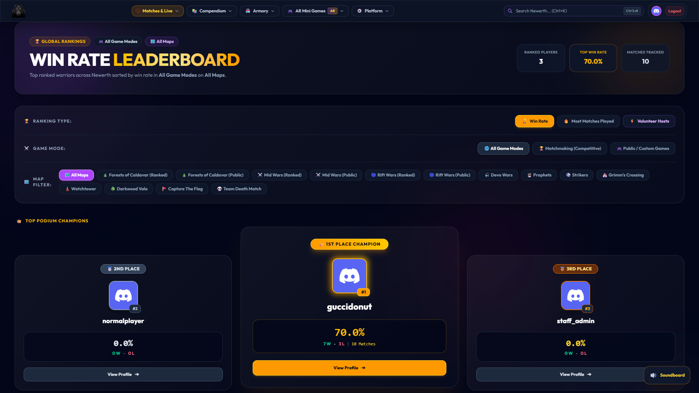
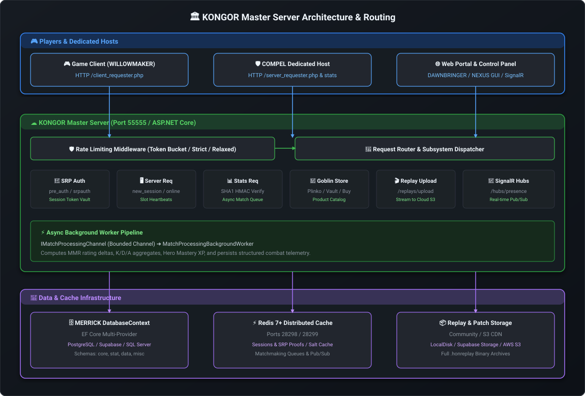
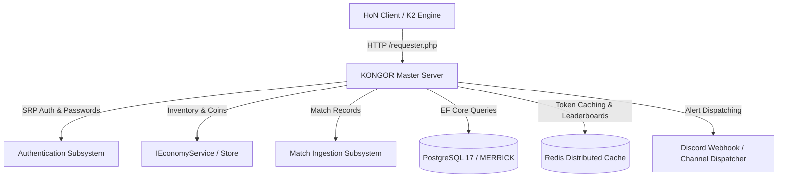

<div align="center">

# 🏛️ KONGOR Master Server
### *Core Game Authentication, Economy & Matchmaking Coordinator*

[](https://dotnet.microsoft.com/)
[](https://dotnet.microsoft.com/)
[](https://www.postgresql.org/)
[](https://redis.io/)

**KONGOR Master Server is the central backend coordinator for Heroes of Newerth. It provides 100% protocol compatibility with the legacy K2 client while operating on a high-throughput, modern cloud-native architecture.**

[⚡ Quickstart](#-quickstart) •
[🛒 In-Game Store](#-in-game-goblin-store--economy) •
[🌟 Key Features](#-key-features) •
[🗺️ Architecture Map](#-master-server-architecture)

---

### ⚡ Quickstart: Launch Master Server
Start the Master Server with MERRICK database and Redis cache in **Windows PowerShell**:

```powershell
kongor master-server
```
*(Or launch the full 9-service cluster: `kongor start`)*  
Default Endpoint: `http://127.0.0.1:55555`

---

</div>

## 🛒 In-Game Goblin Store & Economy

<div align="center">

| 🛒 Merrick's Goblin Store | 📊 Seasonal Leaderboard & MMR |
| :---: | :---: |
|  |  |
| *Avatars, taunts, announcers, and couriers* | *Real-time player MMR/PSR calculation and ranking* |

</div>

---

## 🌟 Key Features

* **🔐 SRP-6a Authentication**: Full implementation of Secure Remote Password authentication, safeguarding player credentials with zero plain-text transmission over the wire.
* **🗄️ Multi-Database Repository Layer (EF Core / MERRICK)**: 100% decoupled repository layer supporting PostgreSQL 17, Supabase, and SQL Server with full DI isolation.
* **🛒 Goblin Store & Economy Engine**: Complete in-game store API (`requester.php?f=get_store_list`, `purchase_item`) with transaction logs and inventory tracking.
* **📊 Match Stats & Ingestion Pipeline**: Ingests binary match stats from dedicated game servers, computes MMR/PSR rating deltas, updates hero leaderboards, and saves replays to cloud storage.
* **🛡️ Polly v8 Resilience & Circuit Breakers**: Standardized Polly v8 pipelines with automated circuit breaking, fallback responses, and health state degradation (`/health`).

---

## 🗺️ Master Server Architecture

<div align="center">
  
</div>

<details>
<summary>🔍 View Mermaid Source</summary>


</details>

---

> [!TIP]
> ### 💡 Database Seeding & Mocking
> The Master Server comes pre-configured with automated database migrations and seeded test accounts. If running in offline test mode, in-memory SQLite / EF Core will activate automatically without external database setup.
