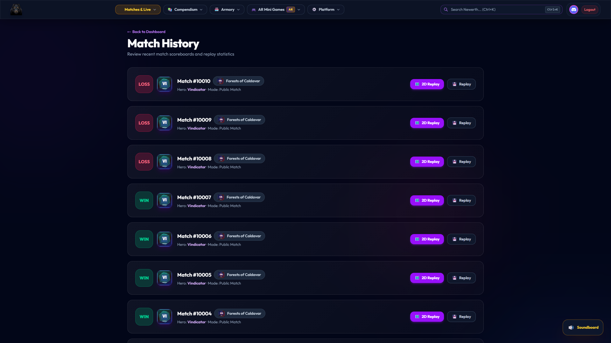
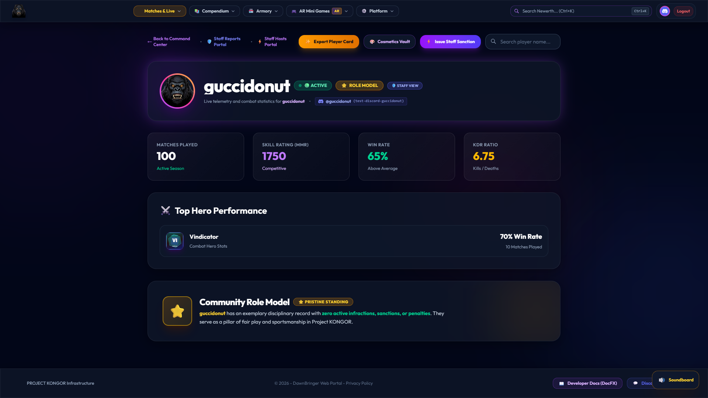

<div align="center">

# 🔌 ZORGATH
### *Web Portal REST API Backend & Match Telemetry Service*

[](https://dotnet.microsoft.com/)
[](https://dotnet.microsoft.com/)
[](https://scalar.com/)
[](https://redis.io/)

**ZORGATH is the secure, high-throughput REST API backend powering the DAWNBRINGER web portal, competitive leaderboards, match timeline analyzer, and external integrations.**

[⚡ Quickstart](#-quickstart) •
[📸 Screenshots](#-match-telemetry-showcase) •
[🌟 Key Features](#-key-features) •
[🔌 Endpoints](#-api-endpoints)

---

### ⚡ Quickstart: Launch Web API
Start the REST API backend in **Windows PowerShell**:

```powershell
kongor web-api
```
*(Or launch standalone: `dotnet run --project src/services/web-api/ZORGATH.WebPortal.API.csproj`)*<br />
Interactive Scalar OpenAPI UI: [`https://localhost:5201/scalar/v1`](https://localhost:5201/scalar/v1) *(with `/swagger` redirecting to `/scalar/v1`)*

---

</div>

## 📸 Match Telemetry Showcase

<div align="center">

| 📜 Match History & Timelines | 📊 Player Performance Radar & Stats |
| :---: | :---: |
|  |  |
| *Match breakdowns, kills/deaths/assists & wards* | *KDR, creep score, win percentages & hero radar* |

</div>

---

## 🌟 Key Features

* **🏆 Real-Time Leaderboards**: Fast queries for player rankings, MMR, PSR, win streaks, and hero mastery stats.
* **📜 Match History & Deep Telemetry**: Complete game timeline, inventory builds, ward placements, and gold graphs.
* **🛡️ JWT & OAuth2 Authentication**: Support for Discord OAuth2 and local session tokens.
* **⚡ Server-Side Output Caching**: Redis-backed cache for public leaderboard and hero stats endpoints.
* **🔒 Rate Limiting & Security Headers**: Strict token-bucket rate limiting and OWASP-compliant security headers.

---

## 🔌 API Endpoints

* `GET /api/leaderboard`: Top player rankings by MMR/PSR and win rate.
* `GET /api/players/{id}`: Detailed player profile, hero stats, and match records.
* `GET /api/matches/{id}`: Full match telemetry, item builds, and timeline events.
* `GET /api/heroes`: All hero definitions, avatars, and abilities.
* `GET /scalar/v1`: Interactive Scalar OpenAPI documentation and test console (`/swagger` redirects here; `/openapi/v1.json` serves the OpenAPI schema).
