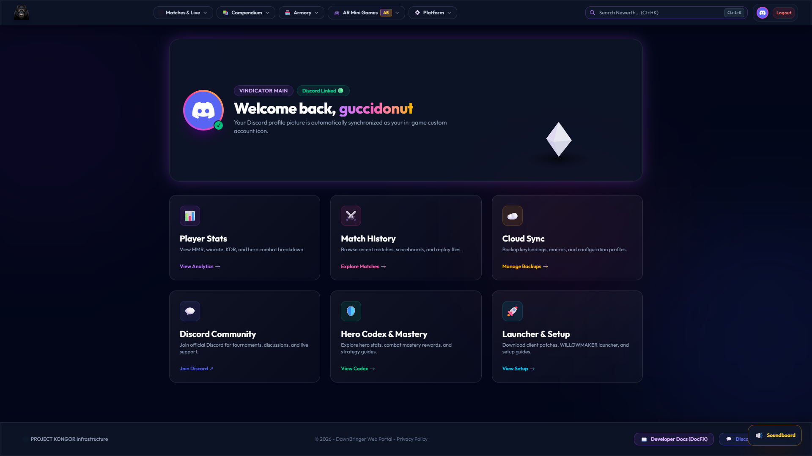
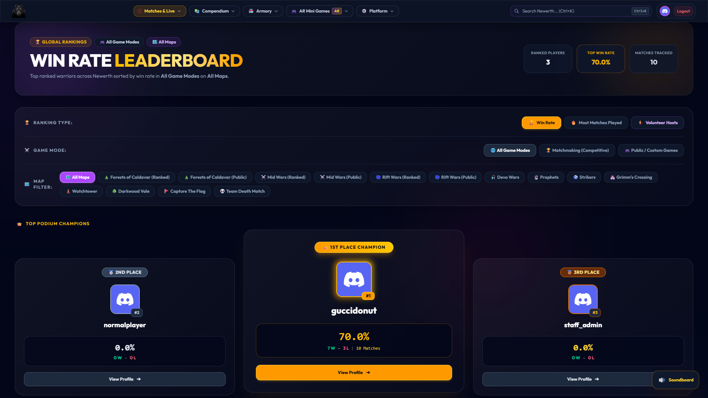
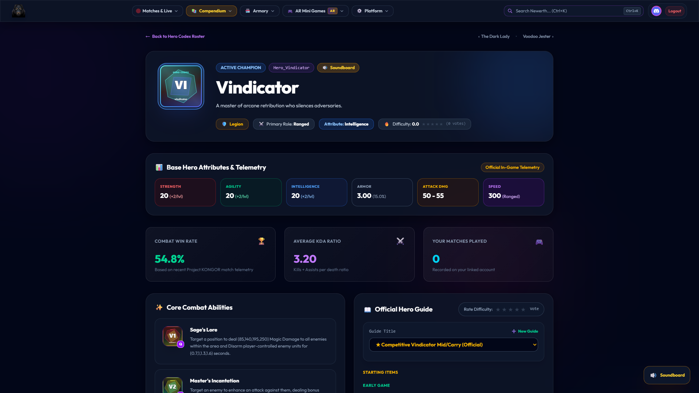
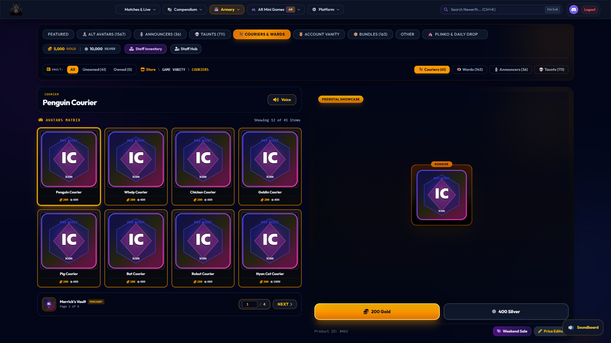

<div align="center">

# 🌐 DAWNBRINGER
### *Community Web Portal & Competitive Analytics Dashboard*

[](https://dotnet.microsoft.com/)
[](https://dotnet.microsoft.com/)
[](https://tailwindcss.com/)

**DAWNBRINGER is the player-facing community web portal and competitive analytics dashboard for ProjectKongor. Built with ASP.NET Core MVC and Tailwind CSS, it features match breakdowns, hero builds, and live ladders.**

[⚡ Quickstart](#-quickstart) •
[📸 Screenshots](#-portal-visual-showcase) •
[🌟 Key Features](#-key-features) •
[🔑 Authentication](#-authentication-flows)

---

### ⚡ Quickstart: Launch Web Portal
Launch DAWNBRINGER locally in **Windows PowerShell**:

```powershell
kongor web-ui
```
*(Or launch the entire cluster: `kongor start`)*  
Endpoints: [`https://localhost:5201`](https://localhost:5201) / [`http://localhost:5200`](http://localhost:5200)

---

</div>

## 📸 Portal Visual Showcase

<div align="center">

| 🌐 Community Portal Landing | 📊 Ranked Seasonal Leaderboard |
| :---: | :---: |
|  |  |
| *Live server announcements, player search & news* | *Top competitive players, winrates, and PSR/MMR tiers* |

| 📘 Hero Codex & Combat Telemetry | 🛡️ Player Armory & Couriers |
| :---: | :---: |
|  |  |
| *Deep hero statistics, skill breakdowns & official guides* | *Couriers, wards, taunts & 3D pedestal showcase* |

</div>

---

## 🌟 Key Features

* **🎨 Modern Responsive Dark UI**: Tailored Tailwind CSS design featuring rich glassmorphism, responsive grid layouts, and custom animations.
* **👤 Player Profiles & Match Detail Pages**: Interactive match charts, hero performance radars, and item progression views.
* **🔑 Dual Authentication Strategy**: Discord OAuth2 for live production login and Mock Email flow for rapid local development.
* **📖 Built-In Developer Docs Link**: Protected navigation providing direct access to the DocFX Developer Documentation Hub (`/docs` -> `http://localhost:8080`), restricted exclusively to authenticated users.

---

## 🔑 Authentication Flows

1. **Local Development (Mock Auth)**:
   * By default in development, DAWNBRINGER includes a zero-friction mock authentication provider allowing instant login as any test user or administrator without external internet access.
2. **Production (Discord OAuth2)**:
   * Links with the official community Discord server to verify user identity and guild roles.
