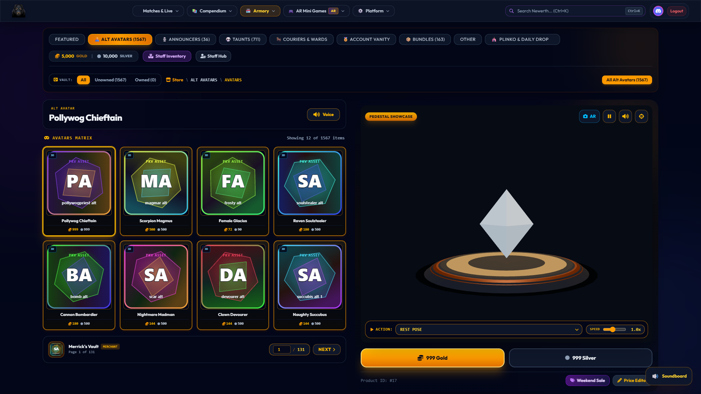

<div align="center">

# 🗿 HoN 3D Model & Animation Pipeline (`io_scene_hon`)
### *Native Blender 4.2+ Extension & glTF 2.0 Asset Pipeline for Heroes of Newerth*

[](https://www.blender.org/)
[](https://www.python.org/)
[](#)
[](#)

**`io_scene_hon` is the native Blender 4.2+ extension add-on and asset pipeline for Heroes of Newerth (HoN). It imports and exports 3D meshes, skeletons, animations, and materials, converting them to standard glTF / GLB 2.0.**

[⚡ Quickstart](#-automated-1-click-installation-recommended) •
[📸 3D Preview](#-3d-asset-preview) •
[🌟 Key Features](#-features--architecture) •
[🎮 Batch CLI](#-cli-usage--batch-conversion)

---

### ⚡ Quickstart: 1-Click Install via Kongor CLI
Download portable Blender 4.2+ LTS and deploy the add-on in **Windows PowerShell**:

```powershell
kongor blender install
```
*(Launch Blender with the add-on enabled: `kongor blender`)*

---

</div>

## 📸 3D Asset Preview

<div align="center">

| 🗿 Interactive glTF 2.0 3D Pedestal Preview |
| :---: |
|  |
| *glTF 2.0 / GLB 3D meshes rendered in the web portal pedestal showcase (cleanroom crystal placeholder shown when game archives are absent)* |

</div>

---

## 🌟 Features & Architecture

* **Blender 4.2+ Extension Architecture**: Native `blender_manifest.toml` (schema_version "1.0.0", type "add-on", permissions ["files"]).
* **SMDL v3 Binary Model Parser & Writer (`smdl_parser.py`, `smdl_writer.py`)**:
  * Chunk-by-chunk binary parsing: `head`, `bone`, `mesh`, `vrts`, `nrml`, `texc`, `tang`, `face`, `lnk3`/`link`, `colr`.
  * Supports 32-bit and 16-bit face indexing, vertex bone skinning weights up to 4 influences per vertex, and inverse/local bone matrices.
* **CLIP v2 Animation Parser & Writer (`clip_parser.py`, `clip_writer.py`)**:
  * Decodes all 10 motion channels per bone: Translation $(X, Y, Z)$, Pitch, Roll, Yaw, Visibility, Scale $(X, Y, Z)$.
  * Exact $ZXY$ intrinsic Euler rotation order: $R = R_z(\text{yaw}) \cdot R_x(\text{pitch}) \cdot R_y(\text{roll})$.
  * Shortest-path Slerp/NLerp interpolation and quaternion normalization.
* **MDF Entity Definition Parser (`mdf_parser.py`)**:
  * Parses HoN `.mdf` XML entity files, resolving model LODs (`high`, `med`, `low`), bone attachments, and animation clip associations.
* **Material & PBR Converter (`material_parser.py`)**:
  * Decodes DDS textures (DXT1, DXT3, DXT5, uncompressed).
  * Unpacks HoN RxGB normal maps: $X$ in Alpha, $Y$ in Green, $Z = \sqrt{\max(0, 1 - X^2 - Y^2)}$.
  * Generates Blender 4.2+ Principled BSDF v2 shader node trees.
* **glTF / GLB 2.0 Exporter (`gltf_exporter.py`)**:
  * Converts HoN models, skeletons, and animation clips directly to standard `.glb` binary containers.
  * Coordinate system conversion: HoN Z-Up right-handed to glTF 2.0 Y-Up right-handed with triangle winding correction.

---

## 🚀 Installation & Setup

### 🌟 Automated 1-Click Installation (Recommended)
```powershell
# Automatically download portable Blender 4.2+ LTS and deploy io_scene_hon addon
kongor blender install

# Launch Blender with add-on pre-enabled
kongor blender

# Stop running Blender instances
kongor blender stop
```

### 📦 Manual Installation
1. Copy or link `src/tools/blender/io_scene_hon/` to your Blender extensions folder:
   * **Windows**: `%APPDATA%\Blender Foundation\Blender\4.2\extensions\user_default\io_scene_hon`
   * **Linux**: `~/.config/blender/4.2/extensions/user_default/io_scene_hon`
   * **macOS**: `~/Library/Application Support/Blender/4.2/extensions/user_default/io_scene_hon`
2. In Blender: **Edit** > **Preferences** > **Get Extensions** > Enable **Heroes of Newerth Model & Animation Pipeline**.
3. Access in 3D Viewport: **N-Panel > HoN** tab or **File > Import/Export**.

---

## 🎮 CLI Usage & Batch Conversion

```powershell
# List all discoverable HoN models and alt avatars
kongor model list

# Export specific hero skin with all skeletal animations baked
kongor model export "thriller rhapsody"

# Open exported model in Blender
kongor blender output/models/thriller_rhapsody.glb
```

---

## 🙏 Acknowledgments & Upstream Credits

* **`KRAT0Sz` / `why2k` (Anton Romanov):** Foundational K2 Blender pipeline ([`KRAT0Sz/K2-Blender-master`](https://github.com/KRAT0Sz/K2-Blender-master), MIT) and modern Blender 4.2+/5.0+ architecture, Slotted Actions, bulk `foreach_set` keyframing, dynamic child-bone sizing, viewport bone toggles, constant-key epsilon compression, and extension packaging patterns ([`KRAT0Sz/KONGOR-TOOL`](https://github.com/KRAT0Sz/KONGOR-TOOL), Apache-2.0).
* **`RedBear`:** Foundational K2 binary format research, engine behavior notes, and community assistance supporting K2 Blender tooling.
