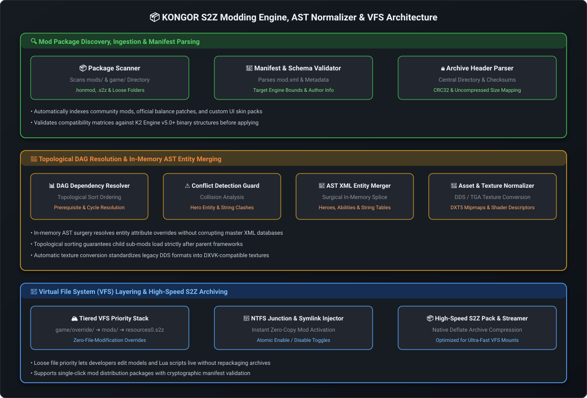

# 📦 Mod CLI (`mod-cli`)

> **Command-line `.honmod` / `.s2z` mod manager, DAG conflict resolver, and rollback journal tool (`net11.0`).**

`mod-cli` wraps `Kongor.Modding` with a `Spectre.Console.Cli` command tree to list, inspect, enable, disable, apply (into `override/` loose VFS or `.s2z` archives), package, and cleanly roll back HoN mods.

---

## ⚡ Quick Start

```powershell
# Via unified Kongor CLI
.\kongor.ps1 mod list
.\kongor.ps1 mod enable <mod>
.\kongor.ps1 mod apply --mode vfs
.\kongor.ps1 mod rollback

# Or run standalone
dotnet run --project src/tools/mod-cli/ModCli.csproj -- list
```

### Key Options
- `--mods-dir <DIR>` — Directory containing `.honmod` packages
- `--client-dir <DIR>` — Target HoN client installation directory
- `--mode <vfs|archive>` — Apply mods to loose `override/` (`vfs`) or `resources999.s2z` (`archive`)

---

## 🗺️ Mod Pipeline Architecture

<div align="center">
  
</div>

---

## 📖 Related Documentation

- [HoN S2Z Modding Engine (`Kongor.Modding`)](../../extensions/modding/README.md)
